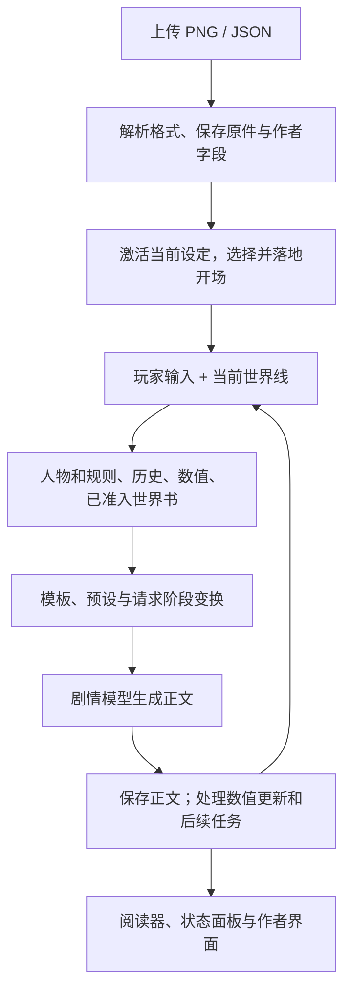

# 社区角色卡：运行机制、迁移与创作入口

NextTavern 把角色卡中的人物、世界书、开场、数值和作者脚本分别接入原生剧情流程。一张卡可以同时提供叙事资料、可计算的状态和交互界面；理解每部分何时被读取、由谁执行，才能判断迁移效果并创作新卡。

本文描述 **0.3 开发线**。0.3 尚未正式发布；使用时请核对实际版本，发行状态见[更新日志](CHANGELOG.md)，开发范围见[开发日志](DEVELOPMENT-0.3.md)。Native **1.0／1.1** 是角色卡文件格式版本，与插件 **0.3** 是两套版本号。

## 阅读路线

| 你要完成的事 | 阅读入口 |
| --- | --- |
| 理解导入、运行、转换与导出的关系 | 本文 |
| 从零写一张可导入的 JSON 原生卡 | [原生卡格式与创作教程](NATIVE-CARD-FORMAT.md)，先完成其中的“雾港灯塔”示例 |
| 设计触发、递归、定时与插入位置 | 本文[世界书作者参考](#4-世界书怎样进入本轮剧情) |
| 用变量与世界书生成动态作者文本 | [EJS 模板与 API](NATIVE-CARD-FORMAT.md#8-ejs-作者模板动态文本与世界书联动) |
| 加入体力、物品、关系等状态，或迁移 MVU／Ruby | [数值状态、MVU 与 Ruby](NATIVE-STATE.md) |
| 编写提示词预设、功能开关与文本正则 | [社区预设与正则](COMMUNITY-PRESETS.md) |

## 1. 运行时如何使用角色卡

卡文件是作者资料包。导入后，程序建立可编辑的设定、世界书和开场来源；每次玩家输入再从当前世界线取出本轮需要的材料，交给剧情模型。模型生成的故事、结构化数值和阅读界面各有自己的处理过程。



这是数据流示意。可选人物协作会在正文生成前参与推演；状态、决策、记忆和 Ruby 有各自的调度条件，不是每回合都必须串行执行一遍。

| 内容 | 运行时的职责 | 对创作的影响 |
| --- | --- | --- |
| 人物与规则 | 提供当前有效的人设、世界约束和叙事要求 | 人物身份、世界事实、叙事方法分别写清，便于编辑与角色协作 |
| 世界书 | 按需提供资料；社区结构化世界书还要经过触发和预算处理 | 不要假设全部条目每回合都在提示词中 |
| 数值 | 保存、计算和提交结构化事实 | “正文说体力减少”与“体力数值已更新”分别观察 |
| 阅读界面 | 显示正文、状态和作者交互 | CSS、显示正则和页面内容不能替代数据提交 |
| 世界线与历史 | 确定本次请求看到哪段故事、哪份状态 | 分支应继承切点事实，不能读取父线后来发生的剧情 |
| 模型任务 | 写故事，或完成显式开启的语义分类、人物推演和辅助分析 | 确定性解析和计算无需额外模型；语义任务会产生实际用量 |

这套分工也体现了数值与 Ruby 的设计定位：**NextTavern 原生数值状态系统和原生分析任务调度，兼容受支持的社区 MVU／RUBY 数据、协议与作者能力。** 状态提交、世界线继承和任务发布由 NextTavern 管理；Ruby 产生后继剧情材料，数值系统保存结构化事实。Schema 作者代码在受支持的隔离执行链中运行，因此兼容也不只是标签解析。详见[原生状态系统的设计定位](NATIVE-STATE.md#设计定位原生运行机制兼容社区协议与作者能力)。

## 2. 文件读取与字段映射

### 可以从什么文件开始

| 文件 | 识别方式 | 用途 |
| --- | --- | --- |
| 社区 JSON v1 | 人物字段直接位于根对象 | 读取传统角色卡 |
| 社区 JSON v2／v3 | `spec: "chara_card_v2"`／`"chara_card_v3"`，作者字段位于 `data` | 读取结构化卡及扩展 |
| 社区 PNG | 从 `tEXt` 块的 `chara`／`ccv3` 元数据解码 JSON | 保留原始 PNG，读取卡资料与头像；同时存在时优先 `ccv3` |
| Native JSON | `spec: "nexttavern_card"`，`spec_version: "1.0"` 或 `"1.1"` | 直接表达 NextTavern 的作者栏目 |
| MD／TXT／DOCX | 沿资料读取和导入流程抽取、整理内容 | 适合非结构化设定；不具有社区 JSON 的直接字段映射合同 |

Native 卡当前使用 **JSON**；把 Native JSON 塞进 PNG 的 `chara` 块不构成受支持的原生卡封装。普通 PNG 插画如果没有角色卡元数据，也不是角色卡。

结构化 PNG／JSON 的字段映射与导入由程序完成，不需要模型逐页重新分类；MD／TXT 等文本设定才走语义审阅。DOCX 可直接交给导入入口，原文件与抽取正文分别保留。

### 社区字段的初始归属

下表中的路径以 v2／v3 的 `data` 为起点；v1 的对应字段在根对象。它描述导入时的基础归属，社区预设还可按原字段组织本轮请求。

| 社区字段 | 基础归属与使用方式 |
| --- | --- |
| `name` | 卡名称与角色身份宏的来源；不会替代完整人物描述 |
| `description`、`personality` | 人物资料；基础映射不会凭空推断长文本里每个人物的独立身份 |
| `scenario` | 核心／场景设定 |
| `system_prompt` | 叙事规则资料；不因此取得修改宿主工具权限的能力 |
| `post_history_instructions` | 回复规则资料；具体请求位置由当前预设和执行链决定 |
| `mes_example` | 示例／文风资料；不作为已经发生的聊天历史 |
| `first_mes`、`alternate_greetings` | 默认与备选开场目录；只落地玩家选中的开场 |
| `character_book` | 保留条目内容及控制字段，交给世界书流程处理 |
| `extensions` | 按实际能力分别接入模板、数值、脚本、正则等；未认识的字段仍保留 |
| `creator_notes`、标签、版本、来源和未知字段 | 保留作者元数据；不是额外一份常驻剧情指令 |

例如，`description` 写着“守塔人负责灯塔，商人经营渡船”，格式解析能完整读取这句话，却不能仅凭字段名得到两个具有各自知识和动机的人物。普通剧情可直接使用它；需要独立角色协作时，再建立人物分类，或从一开始使用 Native 的两条人物记录。

### 原件、当前设定、请求材料和历史

| 数据 | 何时形成 | 修改后的含义 |
| --- | --- | --- |
| 上传原件 | 上传时 | 原字节保留；后续编辑不改原文件 |
| 当前作者设定 | 导入激活、写卡定稿或编辑时 | 决定之后使用的人物、规则、世界书等资料 |
| 本轮请求材料 | 每次准备剧情时 | 根据当前设定、世界线、模板和触发结果形成；不等于整张卡的所有内容 |
| 已保存故事与运行状态 | 开场落地、剧情提交和状态更新时 | 表示这条世界线已发生的事；与作者初始设定分开 |

`archive` 保存往返所需的归档资料，不作为第二份隐藏提示词。导入时保留脚本源码，也不等于当时已经执行该脚本。

## 3. 开场为什么需要单独选择

社区卡的默认开场是 `first_mes`，备选来自 `alternate_greetings`。Native 卡使用 `opening.text` 和 `opening.catalog`；具体格式见[开场字段参考](NATIVE-CARD-FORMAT.md)。

选择开场时，系统把所选原文、身份宏、初始化声明和开场中的数值变化放在同一条来源链上。原文开场沿程序复制路径成为故事中的真实消息，不让模型重新仿写。作者或玩家主动要求“生成开场”时，才走生成任务。

以“雾港灯塔”为例：“从港口出发”可以让来客体力为 10；“风暴中抵达塔顶”可以给出另一套完整初值。选择第二个开场时，不能只替换正文，却沿用第一个开场的数值。初始化的覆盖规则见[数值指南](NATIVE-STATE.md)。

刷新界面不是再次导入，也不应重复插入开场。转换原生人物分类同样不需要重开故事。

## 4. 世界书怎样进入本轮剧情

世界书把“作品中存在的知识”和“本轮需要给模型的资料”分开。作者可以让雾港常识持续出现，让潮洞资料只在探索时进入，让某条线索进一步触发另一条记录；不必把全部背景塞进每轮人物设定。

### 先选对资料格式

| 格式 | 条目写法 | 怎样使用 | 适合什么内容 |
| --- | --- | --- | --- |
| Native `data.worldbook` | `name`、`content`、`aliases`、`keywords`、`triggers`、`alwaysOn`、`priority`、`tokenBudget` 等 | `alwaysOn: true` 的启用行作为常驻背景；其他行由原生查询按本轮查询词、地点和在场人物检索，再按预算选取 | 新卡的背景、地点、物品资料；写法见[原生世界书](NATIVE-CARD-FORMAT.md#3-人物与世界资料怎样分工) |
| `data.character_book` | 社区结构化条目，使用下文的 `keys`、`constant`、`extensions` 等 | 自动扫描当前世界线的消息，计算条件、递归、概率、分组、定时和插入位置 | 需要社区世界书控制语义的卡与迁移作品 |

两者可以共存，但不要同时放入同一份正文来期待“互相补齐”。原生行的 `triggers` 是检索词；结构化条目的 `extensions.triggers` 属于另一套控制声明，当前不支持非空值。原生 `priority`／`tokenBudget` 也不是结构化条目的排序和预算字段。

常驻世界规律放 `rules.core` 或少量常驻资料；可探索的细节放条件条目。世界书内容进入模型上下文，也不等于所有剧中人物都知道它；人物知识边界仍需写进人设和叙事规则。

### 可直接嵌入 `data` 的雾港示例

下面是**完整卡的 `data` 内部片段，不是独立角色卡**。把两个属性并入[“雾港灯塔”完整 1.0 示例](NATIVE-CARD-FORMAT.md#1-从一份能继续创作的卡开始)的 `data`，保留其 `name`、`cards`、`rules` 和 `opening`。这里将原有 `worldbook` 替换成空数组，改用结构化世界书表达背景与潮洞，避免重复保存相同资料。

```json
{
  "worldbook": [],
  "character_book": {
    "name": "雾港资料",
    "entries": [
      {
        "id": 1,
        "comment": "雾港日常",
        "keys": [],
        "content": "雾港以修船和近海捕鱼为生。入夜后常有浓雾，居民靠灯塔辨认航道。异常应先以可观察的迹象出现。",
        "enabled": true,
        "constant": true,
        "insertion_order": 100,
        "position": "before_char"
      },
      {
        "id": 2,
        "comment": "潮洞入口",
        "keys": ["潮洞", "退潮"],
        "content": "灯塔西侧的石阶只在退潮时通向潮洞。洞壁刻着旧航标刻痕，守塔人能指出入口，却不知道洞穴深处的情况。",
        "enabled": true,
        "constant": false,
        "selective": false,
        "insertion_order": 120,
        "position": "after_char",
        "extensions": {
          "scan_depth": 2,
          "prevent_recursion": false
        }
      },
      {
        "id": 3,
        "comment": "旧航标刻痕",
        "keys": ["旧航标刻痕"],
        "secondary_keys": ["潮洞", "石阶"],
        "content": "旧航标刻痕记录过往航道，不是来客留下的私人记号。需要现场辨认后，才能判断其中哪些痕迹与海上孤灯有关。",
        "enabled": true,
        "constant": false,
        "selective": true,
        "insertion_order": 110,
        "position": "after_char",
        "extensions": {
          "selectiveLogic": 0,
          "delay_until_recursion": true,
          "prevent_recursion": true,
          "useProbability": true,
          "probability": 100
        }
      },
      {
        "id": 4,
        "comment": "暂不采用的邀请信方案",
        "keys": ["邀请信"],
        "content": "这是作者停用的备用方案，不应进入当前剧情。",
        "enabled": false,
        "constant": false,
        "insertion_order": 90,
        "position": "after_char"
      }
    ]
  }
}
```

在预算足够、当前采用默认递归策略时：

- “雾港日常”无需关键词即可进入候选，但仍受预算等控制。
- 本轮输入“来客询问退潮后能否沿石阶进入”会命中“潮洞入口”。它的正文含“旧航标刻痕”，可在递归扫描中触发第三条；第三条还要求扫描材料含“潮洞”或“石阶”。
- 第三条只在递归阶段参与，且自己的正文不会继续带动下一轮关键词递归；它不是开局就已被人物发现的事实。
- 第四条保持禁用，即使输入包含“邀请信”也不会自动激活。

换成无关输入时，第二、三条是否命中还要看扫描窗口里是否残留上条消息的关键词。要比较“命中／未命中”，应同时核对最近消息，不能只看当前一句话。

### 结构化条目的字段与缺省值

以下是当前固定导入配置的实际解释。它区别于其他前端的新建条目编辑器默认值。新写条目建议显式提供 `keys`、`content`、`enabled` 和 `insertion_order`；常驻条目也写 `keys: []`。

| 条目根字段 | 类型与缺省 | 运行含义 |
| --- | --- | --- |
| `id` | 可省略；提供时为字符串或安全整数，同书内不能重复 | 来源身份；省略时使用原序号，不是本地运行权限 |
| `comment`、`name` | 作者元数据；标题通常用 `comment` | 方便编辑和模板按标题查找，不作为隐含关键词 |
| `content` | 必填字符串 | 条目正文，可按受支持的模板链生成动态文本 |
| `keys` | 必填字符串数组，可为空 | 主关键词；普通候选至少命中一个 |
| `secondary_keys` | 字符串数组，缺省 `[]` | 次关键词，配合 `selective` 与逻辑控制 |
| `enabled` | 布尔值，**缺省 `false`** | 是否允许自动求值；只写 `disable: false` 不等于打开此开关 |
| `constant` | 布尔值，缺省 `false` | 绕过关键词准入；不会绕过禁用、定时、概率、分组和预算 |
| `selective` | 布尔值，缺省 `false` | 是否检查次关键词条件 |
| `insertion_order` | 必填有限数字，绝对值不超过 1,000,000 | 候选排序；较大值优先争取预算 |
| `position` | 缺省 `after_char`；根字段接受 `before_char`／`after_char` | 人物资料前／后；高级位置放入 `extensions.position` |
| `extensions` | 对象，可省略 | 下表列出的高级控制必须放在这里 |

`entries` 在 Native 卡中可用数组或对象；社区 CCv2／CCv3 的受支持结构化求值入口要求数组。为方便迁移与工具交换，上例使用数组。Native Schema 对条目主要约束 `content`；通过 Schema 不表示缺失的 `keys` 或排序值已被运行时补全。非必填控制的 `null` 按缺省处理；布尔值请用 JSON 的 `true`／`false`，不要使用字符串 `"true"` 或数字 `1`。

**旧别名可保留，不会自动替代上述控制。** 当前编译器把根级 `key`、`keysecondary`、`disable`、`order`、`priority`、`case_sensitive`、`use_regex`、`selectiveLogic`、`match_whole_words`、`token_budget`、`role`、`depth` 保留为旧声明，不用于覆盖 canonical 字段。例如迁移时应把 `key` 明确整理成 `keys`，把 `order` 整理成 `insertion_order`，把大小写控制放到 `extensions.case_sensitive`。不要同时填写两套互相矛盾的值。

书级 `scan_depth`、`token_budget`、`recursive_scanning` 也只保留声明，**不会设置本轮全局扫描或预算**。当前默认运行策略是：扫描最近 2 条消息、忽略大小写、不要求全词、允许递归、最多 32 个扫描步骤、世界书预算 2,048。会话的“世界书预算”设置可覆盖预算；`0`／空值表示使用默认值。条目的 `extensions.scan_depth` 等可按下表覆盖本条目的相应行为。

### 关键词、次条件、正则与扫描范围

| `extensions` 字段 | 类型／缺省 | 作用 |
| --- | --- | --- |
| `selectiveLogic` | 数字枚举，缺省 `0` | `0`＝AND ANY，次词任一命中；`1`＝NOT ALL，次词不全命中；`2`＝NOT ANY，次词全部不命中；`3`＝AND ALL，次词全命中 |
| `case_sensitive` | 布尔值或 `null`，缺省 `null` | `null` 继承运行策略；字面关键词是否区分大小写 |
| `match_whole_words` | 布尔值或 `null`，缺省 `null` | 单个无空格词按 ASCII 字母、数字、下划线边界匹配；带空格的短语仍按字面包含匹配 |
| `scan_depth` | 非负整数或 `null`，缺省 `null` | `null` 继承扫描深度；数字按消息条数计，`0` 使此条目的关键词扫描文本为空 |
| `match_persona_description`、`match_character_description`、`match_character_personality`、`match_character_depth_prompt`、`match_scenario`、`match_creator_notes` | 布尔值，各缺省 `false` | 显式把相应玩家／人物／场景／作者说明资料加入本条目的扫描材料；实际值来自当前捕获资料 |

普通候选先要求至少一个主词命中，再检查次条件。`selective: false` 或次词数组为空时不做次条件过滤；次逻辑不会把主关键词的“任一命中”改成“全部命中”。`constant`、正在 sticky 的条目及显式模板激活可跳过关键词门，但不是免除所有后续控制。

关键词可以使用普通文本，也可以使用 `/表达式/flags`，例如 `"/退潮|潮洞/u"`。斜杠形式本身决定正则模式，无需根级 `use_regex`；正则使用自己的 flags，不再套用字面词的大小写或全词设置。支持 `i`、`m`、`s`、`u`，`g` 不改变单次命中测试，`y` 明确不支持；重复或未知 flags、无效或超时的正则会报告失败。不要把 `{{宏}}` 或 EJS 放进关键词，当前关键词匹配没有模板执行合同。

扫描从当前世界线最近消息向前取，包含本轮实际玩家输入和已完成的剧情消息，默认还带说话者名称。它不是“最近两回合”，也不是搜索全部聊天或检索记忆库；工具握手不作为额外故事消息。`scan_depth: 0` 也不会仅跳过聊天而保留全局字段或递归文本。需要老线索一直有效时，设计明确的常驻事实、状态条件或再次触发方式，不依赖某个词曾经在历史里出现过。

### 递归、概率、分组与定时

| `extensions` 字段 | 类型／缺省 | 实际控制 |
| --- | --- | --- |
| `prevent_recursion` | 布尔值，缺省 `false` | 本条目的内容不贡献到下一轮关键词递归；不阻止它自己被其他条目触发 |
| `exclude_recursion` | 布尔值，缺省 `false` | 正常启用递归时，不让本条目在递归扫描阶段作为新候选；初始扫描仍可命中 |
| `delay_until_recursion` | 布尔值或非负整数，缺省 `false` | `true` 相当于延后等级 1；仅在递归阶段达到相应延后等级时参与，不是“等待一条聊天消息” |
| `useProbability`、`probability` | 布尔值／0–100 数字，缺省 `true`／`100` | 启用时按百分比抽取；`false` 跳过概率门。sticky 有效期间不再因概率失败而退出 |
| `group` | 字符串，缺省空串 | 同名非空组执行互斥选择；当前不支持 `"a,b"` 形式的多组成员 |
| `group_override` | 布尔值，缺省 `false` | 组内存在 override 时，按 `insertion_order` 等稳定顺序选择优先项 |
| `group_weight` | 非负数字，缺省 `100` | 没有 override 时的组内加权选择权重 |
| `use_group_scoring` | 布尔值或 `null`，缺省 `null` | 继承或显式启用关键词命中评分；参与评分筛选的成员先比较得分，再执行组选择 |
| `sticky` | 非负整数或 `null`，缺省 `null` | 成功准入后在持续区间继续参与，不要求重新命中关键词 |
| `cooldown` | 非负整数或 `null`，缺省 `null` | 冷却区间内阻止再次激活；sticky 到期时可转入受保护的冷却 |
| `delay` | 非负整数或 `null`，缺省 `null` | 当前聊天坐标未达到此数时不参与；不是首次命中后再等待这么久 |

递归是“本轮扫描的反馈”，不会额外调用模型或新增剧情消息。它可以让“潮洞入口”的已选正文提供“旧航标刻痕”这个新词，并在同一次请求准备中继续扫描。已准入条目会去重，循环引用不会无限追加；达到本轮扫描步数上限后停止。`delay_until_recursion` 控制的是本轮递归等级，与持久 `delay` 不同。

组选择发生在概率和预算之前。普通同组项已有一个获准激活后，后续递归不会再补选另一个成员；当前 sticky 成员有优先保留规则，也可能同时保留多个已有 sticky 项。因此不要把互斥 group 当作业务上“永远只能有一个真值”的数值约束。概率或组抽取由当前请求快照的种子确定，同一冻结尝试可复现，不能通过重复读取状态不断重抽。

定时字段按当前世界线的**聊天消息坐标**计数，包含实际玩家输入和已完成正文，不按墙钟、工具调用数或 HTTP 重试计。区间使用起点／终点坐标，达到终点即过期；`sticky: 2` 不应直接翻译成“保证接下来两个完整玩家回合”。条目有效内容或控制编辑后，旧定时关联会失效；无关来源记账不会重置计时。

计时在本轮请求材料实际发布后记录；随后 provider 失败不代表计时从未发生。同一已发布计划的重试不会再次叠加一份计时。分支沿实际历史切点继承已有记录，不能读取父世界线后来新增的持续或冷却状态。

### 预算、排序与注入位置

结构化世界书使用本轮共享预算，根级 `token_budget` 不等于每条独占配额。当前运行计数使用 `ceil(UTF-16 长度 / 2.5)` 的明确估算，而不是声称与所有模型 provider 的 tokenizer 完全相同。动态条目先渲染，再对实际候选文本累计计数；达到或超过预算的普通候选被排除。溢出后不会继续尝试填入后面的较短普通条目。

`extensions.ignore_budget: true` 可让条目越过世界书预算门，缺省 `false`；它不能扩大模型的总上下文容量。`constant` 也仍可能因为预算不足而缺席，所以必须始终遵守的核心规则更适合放 `rules.core`。缩短重复常驻资料通常比把所有条目设为忽略预算更有效。

候选先按 sticky 优先、`insertion_order` 较大优先，再按原书顺序处理。最终放入同一位置时，普通位置按较小 order 在前、较大 order 在后排列；named outlet 保持较大 order 在前。排序值同时影响预算竞争和相对位置，不宜笼统理解为“数字越大越靠前”。

| `extensions.position` | 位置 | 当前注入语义 |
| --- | --- | --- |
| `0` | 人物资料前 | 进入系统作者材料的对应槽位；根级 `position: "before_char"` 等价 |
| `1` | 人物资料后 | 默认位置；根级 `position: "after_char"` 等价 |
| `2`／`3` | 作者注释前／后 | 适配到 NextTavern 本轮实际生成的导演笔记 user 消息前／后；不是照搬另一前端的作者注释设置 |
| `4` | 聊天深度 | 使用 `extensions.depth` 和 `extensions.role` 请求插入历史位置 |
| `5`／`6` | 示例前／后 | 进入作者示例组的相应槽位 |
| `7` | named outlet | 收集到指定 outlet，必须显式引用，不会自动追加到剧情提示词 |

`extensions.position` 提供有效值时优先于根级 `position`。`extensions.depth` 缺省 `4`，接受非负整数；`extensions.role` 是数字枚举，`0`＝system、`1`＝user、`2`＝assistant，缺省 `0`。两者实际控制聊天深度位置；其他系统槽位不因设置 `role: 2` 就变成 assistant 消息，作者注释位置则跟随实际导演笔记的 user 角色。根级 `role`／`depth` 只是保留旧声明。

深度 `0` 请求位于聊天尾部；更大值从尾部向前。最终可用的锚点和角色由实际 Native 请求与模型路由确认，路由不支持某种角色或深度时会阻断，不会悄悄改角色或移到其他位置。先使用默认人物前／后位置，确实依赖历史位置时再逐项核对目标模型路由。

outlet 需要同时写 `extensions.position: 7` 与非空 `extensions.outlet_name`，再在本轮后续作者模板／规则中放 `{{outlet::雾港补充}}` 这样的宏引用。它读取的是同名 outlet 本轮实际准入结果；未命中时为空，不会自动把全书拼进去。outlet 插入后不再递归展开其中的宏，也不要让条目依赖自身尚未形成的 outlet 结果。

引用还必须位于本轮实际参与请求的字段中。例如默认“沿用系统美学”会排除 `rules.narrative/reply/style`；玩法必需的出口放在这些字段里，即使条目获准也不会被消费。常驻玩法说明可放 `rules.core`。

### 本轮求值、模板与排错顺序

1. **捕获当前资料。** 合并已保存条目编辑、启用状态和当前世界线历史；确定本轮扫描消息、预算、随机种子与定时坐标。
2. **准备模板资料。** 绑定本轮变量与初始资料。世界书目录可供受支持的模板查询，但不会预先独立执行全部条目的 EJS。
3. **选候选。** 按启用、延迟／冷却／sticky、常驻或关键词、次条件、分组和概率处理；递归可以产生下一批候选。
4. **渲染并计预算。** 选中的作者条目按宏→独立 EJS→累计预算处理；未被选中的条目不会因此执行一次独立 EJS。模板查询和显式激活的详细合同见[EJS 与世界书联动](NATIVE-CARD-FORMAT.md#8-ejs-作者模板动态文本与世界书联动)。
5. **形成最终材料。** 对获准世界书运行 WORLD_INFO 请求阶段正则，再建立系统槽位、聊天插入和 outlet；后续作者模板读取本轮 outlet。此处的正则不会倒回去改变已完成的关键词选择或预算准入。
6. **随请求发布。** 只有实际进入本轮材料的正文才交给模型；定时记录沿这次发布保存。下一轮重新求值，上一轮提供过的条目不会因“模型已经读过”就自动永久生效。

要区分“候选命中”“模板已渲染”“最终注入”。例如动态正文可能渲染后超预算；预算溢出后的部分候选也可能仅作为受限递归扫描资料。不能仅凭发现它的关键词或模板执行记录就断言正文已经注入。

| 现象 | 按顺序检查 |
| --- | --- |
| 条目保存了却从未出现 | `enabled` 是否显式为 true；是否有 `keys`、`content`、`insertion_order`；是否误用旧别名或把高级字段放在根级 |
| 当前输入没提到，条目却命中 | 最近扫描消息和说话者名、常驻／sticky、全局资料匹配开关，以及其他条目带来的递归词 |
| 主词命中仍没出现 | 次条件、delay／cooldown、递归限制、group 输赢、概率、预算及最终插入位置 |
| 改书级扫描或预算无效 | 它们是保留声明；用实际会话预算设置，扫描覆盖使用条目 `extensions.scan_depth` |
| 带 EJS 条目报错或没有预期效果 | 是否实际选中；模板作用域与 API 是否可用；区分渲染前查询、最终 outlet 和事后请求正则 |
| outlet 有条目却没出现在正文提示词 | 是否存在同名显式引用；引用时机是否在本轮求值完成后；条目是否真正获准 |
| 一加旧扩展就整轮阻断 | 查看首个具体诊断，检查枚举／字段类型、关键词宏、非法正则和当前不支持的控制 |

目前 `extensions.vectorized: true` 采用带诊断的关键词回退，不执行 Embedding 检索；`extensions.automation_id` 非空、`extensions.triggers` 非空、多组成员、未支持的 `@@` 装饰指令和关键词模板不能作为可执行能力使用。未知字段会作为元数据保留，不会自动改变准入或运行外部代码。结构化求值、模板和正则的程序步骤本身新增模型请求为 0，但本轮获准文本的长度会改变 Story 输入用量。

实现核对入口：[字段与固定缺省](https://github.com/a86582751/dsh-nexttavern/blob/main/src/core/tavern-lore-fixed-profile.mts)、[编译与旧声明](https://github.com/a86582751/dsh-nexttavern/blob/main/src/core/tavern-lore-compiler.mts)、[扫描与求值](https://github.com/a86582751/dsh-nexttavern/blob/main/src/core/tavern-lore-evaluator.mts)、[模板与正则顺序](https://github.com/a86582751/dsh-nexttavern/blob/main/src/core/roleplay-tavern-prompt-render.ts)、[注入位置](https://github.com/a86582751/dsh-nexttavern/blob/main/src/core/roleplay-tavern-layout.ts)。

## 5. 模板、脚本、正则与页面分别做什么

| 能力 | 主要工作 | 作者要确认的条件 |
| --- | --- | --- |
| 身份宏、提示词宏 | 把玩家、角色或预设变量替换为本轮资料 | 当前上下文是否提供该值；预设变量与 MVU 数值不是同一命名空间 |
| EJS 模板 | 在请求准备阶段读取允许的资料、生成动态作者文本 | Native 卡可直接使用受支持的模板，具体字段、`getvar`／`getwi` 及注入时序见[EJS 作者章节](NATIVE-CARD-FORMAT.md#8-ejs-作者模板动态文本与世界书联动) |
| MVU／Schema 作者程序 | 初始化、更新和推导数值 | 选用对应状态协议与执行链，见[状态指南](NATIVE-STATE.md) |
| 请求正则 | 修改送给模型的相应文本材料 | 检查作用来源、placement、深度与 prompt 标记 |
| 阅读正则、HTML／CSS | 修改玩家看到的显示 | 不将显示后的文字当成历史原文或数值提交证据 |
| 作者浏览器脚本 | 处理页面交互，通过已接入接口读取或修改资料 | 检查具体 API、资源及生命周期；不是完整的 SillyTavern 页面环境 |

作者脚本经编译和能力适配后，由相应的服务端执行链或浏览器执行链运行。服务端数值初始化完成与浏览器页面可交互是两个阶段；阅读器重新挂载页面，不应重新执行一次服务端初始化。页面刷新后重新绑定事件，与重复提交一次“购买物品”也不是同一件事。

迁移带按钮、手机页面或人物编辑器的卡时，先列出它真正调用的接口：读数值、写数值、读写世界书、保存人物、触发生成、加载媒体分别核对。仅检查 HTML 能否显示，无法证明这些动作有效。当前没有完整 TavernHelper／SillyTavern／Node API 的兼容承诺；未知调用和缺失资源应根据实际提示处理。

图片、背景和音乐链接是资源引用。原卡只写了 URL 时，归档能保留 URL，却没有获得对应资源的字节。发布时注明资源依赖与获取方式；资源库可用性和当前链接可访问性也需要分别检查。智脑插件当前未支持，原生记忆不能作为其兼容实现来宣称。

## 6. 普通游玩、Native 1.0 与转换后的 1.1

### 从零创作通常选 1.0

Native 1.0 允许作者直接分别填写人物、规则、世界书和开场。人物栏目清晰时，系统可以直接使用这些分类；无需为了普通游玩再让模型猜一次字段归属。先完成[完整 1.0 示例](NATIVE-CARD-FORMAT.md)，再按需要加入数值、预设和页面。

角色协作会为参与人物建立各自的推演上下文，包含自身人设和当前可用的剧情资料，再由主剧情模型协调结果。人物建议并不直接成为正史。玩家身份和禁用人物不应参与 NPC 集群；作者应把各个人物的身份与知识边界分开写。

### 社区混合资料可以转换为 1.1

普通社区卡 **不以完成转换为前提**。转换解决的是“如何从混合长字段中获得高级人物与规则分类”，用于角色协作以及依赖这些分类的功能。

1. 捕获当前作者资料，形成这次分类的固定输入。
2. 模型判断哪些原文属于哪个人物、规则或其他栏目，并返回位置和归属。
3. 程序根据位置复制原文，构造高级视图；不让模型重写一份人物设定替换原作。
4. 保存转换文件，或应用到当前会话。相关作者资料改变后，旧分类需要更新。

1.1 保留两种不同用途的视图：

```text
data.compatibility.authorExecution.cards / rules
    → 完整作者执行资料 → 普通剧情

data.cards / rules
    → 分类后的高级视图 → 人物协作等高级消费者

data.worldbook / character_book
    → 原有世界书流程 → 本轮获准的资料
```

普通剧情不会把两套人物与规则重复注入。分类也不能借“引用了某世界书条目”绕过该条目的启用和触发条件。

应用转换结果只更新相应绑定，不重插开场、不增加故事轮次、不修改已发生的正文。取消或失败时仍可普通游玩。有效分类且来源未变时直接复用；动态 EJS 混合规则等材料可能只能部分用于高级人物功能，界面会分别说明可用情况。

开发版中的入口是卡片导入页／资源库里的“转化为 NextTavern 原生卡”，以及依赖人物分类的功能面板。转换完成后检查人物归属，再下载或应用。**仅把 `spec_version` 从 `1.0` 改为 `1.1` 不会完成转换。**

## 7. 导出与迁移的结果

| 目的 | 选择 | 包含什么 |
| --- | --- | --- |
| 保存最初收到的卡 | 导出上传源文件 | 当时上传的字节、名称和格式；不包含后续编辑 |
| 分发现在修改好的卡 | 导出 NextTavern 原生卡 | 当前保存的作者设定与必要兼容资料；有效原生结构走程序合并，需语义归属时可触发分类 |
| 交给支持社区格式的工具 | 对应社区 JSON 导出 | 依该格式保存受支持的当前资料；不保证其他前端执行 Native 专有能力 |
| 分享本次游玩的故事 | 小说／故事导出 | 选定世界线的故事；默认确定性导出与主动语义重组分开 |

原生卡是可移植的**作者设定**，不是整个会话的备份。它不携带全部聊天、任务状态、外部插件存档或当前背包快照。互动写卡没有上传原件时，源文件入口也会保存当前原生卡。

例如：导入 `雾港.png`，修改守塔人的设定，然后导出 `雾港.json`。PNG 仍是最初原件，JSON 是现在的卡；把 JSON 传给朋友后，朋友那次导入的原件就是 JSON，无法由此恢复早期 PNG 的原始字节。DOCX 的抽取文本同样不是 DOCX 原件。

## 8. 哪些工作需要模型

| 操作 | 模型请求的影响 |
| --- | --- |
| PNG／JSON 解码、标准字段映射、原件保存 | 确定性处理不新增分类请求；不能据此说整个导入工作流没有任何模型任务 |
| 复制选定原文开场 | 复制本身新增 0 次 |
| 世界书准入、模板、正则、纯数据数值计算 | 程序执行，新增 0 次；材料长度可能改变 Story 的 token 用量 |
| 普通 Story | 正常调用剧情模型，工具续步或 provider 重试会影响实际次数 |
| 开启角色协作 | 每个参与人物需要推演；主剧情还需结合结果继续生成 |
| 显式人物分类、生成开场、语义重组 | 创建对应模型任务；一次任务可能包含多次实际请求 |
| Ruby | 按任务命中条件调度，具体周期、重试和费用见[状态指南](NATIVE-STATE.md) |

作者可以先做无脚本、无额外分析任务的文本卡，再逐项加入所需能力。这样能看清哪项机制改变了玩法、输入长度或等待时间。

## 9. 从作品到可分发卡的检查流程

以下检查围绕玩家能观察到的结果，不要求为每次文字修改重新跑完整矩阵。

1. **最小卡。** 按[原生卡教程](NATIVE-CARD-FORMAT.md)建立人物、规则和一个开场，确认人物、玩家身份和正文分别进入正确位置。
2. **逐个开场。** 检查选中的正文、身份宏和初始数值；切换开场时不要沿用另一开场的存档来代替新开局验证。
3. **世界书。** 用能触发和不能触发的输入各观察一次需要的条目，检查常驻约束与隐藏设定有没有混放。
4. **数值。** 验证一次明确行动前后的变化，以及规则要求的边界；看数值面板和下一轮实际行为，而非只看状态 HTML。
5. **交互。** 对作品依赖的按钮执行真实操作，核对保存、刷新、切换世界线后的结果。外部资源单独检查。
6. **编辑和分支。** 在一个已知剧情切点创建分支，确认继承该处的资料和状态；后续父子线各自推进。若卡依赖重生成或正文编辑，也检查相应状态结果。
7. **导出往返。** 导出当前卡，在新对话导入，核对作者栏目、开场和必要兼容资料。完整往返不要用“文件能打开”代替。

分发说明建议写明：目标 NextTavern 版本、卡格式版本、所需预设与脚本、外部资源、可选分析任务，以及你实际检查过的玩法。这样使用者可以区分“纯文本可玩”与“某个复杂界面也已验证”。

## 10. 问题定位与开发入口

### 如何读导入能力报告

导入报告描述的是解析时看到的资料，不是整张卡的最终玩法测试报告。

| 标记 | 含义 | 下一步 |
| --- | --- | --- |
| `interpreted` | 已识别为字段、开场或世界书等资料 | 继续检查实际请求、数值与界面结果 |
| `preserved-unexecuted` | 保留了原内容，导入盘点没有执行它 | 检查对应运行能力及所需 API；不要仅凭保留就认定可执行 |
| `missing-external-resource` | 文件未封装所引用的外部资源 | 提供资源或检查引用；该标记不等于已经探测 URL 失效 |
| `requires-optional-analysis` | 发现需要可选分析的配置 | 检查对应任务配置和开关，不表示已经发生分析调用 |

| 表现 | 优先检查 |
| --- | --- |
| 导入成功，但人物行为不对 | 当前人物与规则、预设是否覆盖了相关材料；混合字段的高级分类是否正确 |
| 世界书有条目却不生效 | 当前书籍、`enabled`、关键词与扫描范围、分组／定时状态、预算和插入位置 |
| 正文说数值变了，面板没变 | 初始数据、模型实际更新块、协议执行结果与当前世界线 |
| 页面能显示，按钮无效 | 实际 API 调用、资源、交互处理与保存结果 |
| 导出内容还是最初那张卡 | 是否选了“上传源文件”，而非“当前原生卡” |
| 转换完成，部分高级功能仍提示限制 | 区分静态人物已分类与动态规则可否供该功能使用 |

反馈时附版本、文件格式、所选开场、预设、触发步骤、预期结果和实际提示即可。优先提供可公开的最小卡，去掉凭据与私人对话。

### 工具开发者从哪里读代码

以下是实现入口，方便核对格式和行为；内部函数不是对第三方承诺的稳定 SDK：

| 要核对的机制 | 源码／格式 |
| --- | --- |
| 文件识别、社区字段映射、开场目录、能力报告 | [tavern-card.ts](https://github.com/a86582751/dsh-nexttavern/blob/main/src/core/tavern-card.ts) |
| Native 可移植作者数据与执行视图 | [nexttavern-card.ts](https://github.com/a86582751/dsh-nexttavern/blob/main/src/core/nexttavern-card.ts)、[JSON Schema](https://github.com/a86582751/dsh-nexttavern/blob/main/schema/nexttavern-card-v1.schema.json) |
| 人物分类与高级资料 | [native-card-conversion.ts](https://github.com/a86582751/dsh-nexttavern/blob/main/src/core/native-card-conversion.ts)、[native-card-advanced-material.ts](https://github.com/a86582751/dsh-nexttavern/blob/main/src/core/native-card-advanced-material.ts) |
| 结构化世界书的编译与本轮求值 | [tavern-lore-compiler.mts](https://github.com/a86582751/dsh-nexttavern/blob/main/src/core/tavern-lore-compiler.mts)、[tavern-lore-evaluator.mts](https://github.com/a86582751/dsh-nexttavern/blob/main/src/core/tavern-lore-evaluator.mts) |

接下来可直接复制[完整 Native 1.0 示例](NATIVE-CARD-FORMAT.md)，开始自己的作品。
