# dsh-NextTavern

**简体中文** · [English](README.en.md)

**NextTavern 是 DeepSeek Harness 的长篇角色扮演插件。** 导入社区卡、选择作者开场，在「酒馆」里操作卡内前端。数值、世界书和分析材料随剧情推进。你可以回到已保存的情节另开世界线，也可以把正文和自己的角色卡导出。

**0.3.0-rc.1** · 最低 **DeepSeek Harness 0.2.2-rc.5** · Web / 官方 Windows Desktop · GPL-3.0-only

[GitHub 发行包](https://github.com/a86582751/dsh-nexttavern/releases/tag/v0.3.0-rc.1) · [下载安装](#一键安装) · [0.3 新变化](#03-有什么新变化) · [核心能力](#核心能力) · [开始体验](#开始体验) · [官网](https://a86582751.github.io/dsh-nexttavern/) · [更新日志](CHANGELOG.md) · [截图集](SCREENSHOTS.md) · [Android 路线](#android) · [反馈问题](https://github.com/a86582751/dsh-nexttavern/issues/new/choose)


## 0.3 有什么新变化

0.2.9 已经能导入社区卡、保留原件、查阅世界书，也有静态美化和原生文风库。0.3 将作者的开场、页面操作、数值更新与分析材料接入剧情。遇到带建角界面的卡，可以先选开场、在卡内完成建角，再沿同一条世界线续玩。

| 0.3 的变化 | 玩家和作者现在可以做什么 |
| --- | --- |
| [社区卡导入与作者开场](#社区卡导入与作者开场) | 预览默认及备选开场，选定后呈现作者原文，套用玩家名称和该开场的初值。 |
| [作者前端与交互](#作者前端与交互) | 在「酒馆」里使用卡内建角表单、选择按钮和状态栏，从「前端设置」重新打开已识别的作者悬浮窗。 |
| [MVU 数值状态机](#mvu-数值状态机) | 让角色属性、物品和关系随剧情结算，从已保存的剧情切点开分支，并查看或手动修订当前世界线数值。 |
| [Ruby 额外分析](#ruby-额外分析) | 按作者设置的轮次和关键词分析，保存结果供后续剧情使用，也可在酒馆管理中手动运行、查看结果或切换方案。 |
| [结构化世界书与 EJS](#结构化世界书与-ejs) | 导入独立世界书，按全局、角色或聊天绑定。通过触发条件和模板决定本轮送入模型的设定。 |
| [社区预设与正则](#社区预设与正则) | 导入社区 JSON 预设，调整提示词顺序、功能组、宏和正则，按全局或对话生效。 |
| [原生创作、世界线与侧边聊天](#原生创作世界线与侧边聊天) | 用 Native 1.2 编辑与分享卡片，在侧聊里讨论或修订设定，再续写并导出所选世界线的原稿。 |

重构后先对两批各 10 张随机抽取的社区原卡做分项实测，再加测 5 张。加测的 5 张均走通作者开场和第一轮剧情，并按卡检查数值、状态栏、作者终端或续玩。发布前还在官方桌面版额外手测，对开场确认、建角界面和阅读布局等问题做了定点复验。兼容范围取决于卡片使用的 API、外部资源和模型渠道。[实卡测试覆盖](DEVELOPMENT-0.3.md#实卡测试覆盖)

从 0.2.x 迁移请先导出需要的角色卡或小说，并使用新 home 和工作区。旧会话继续留在原环境。[迁移与回滚](#更新卸载与回滚)

## 一键安装

### 官方 Windows 桌面版（推荐）

1. 安装并打开 DeepSeek Harness。这里提供已验证的 **0.2.2-rc.5** 固定版本，方便在宿主更新后仍能下载这一版。[下载官方 Windows x64 安装程序](https://download.deepseek.com/dsh-desk/bin/win-x64/deepseek-harness-0.2.2-rc.5-win-x64.exe)
2. 打开「设置 → 插件」，点击「添加插件」旁的下拉箭头，选择「安装第三方插件」。
3. 在安装框填入 `dsh-nexttavern@0.3.0-rc.1`，点击「安装」。安装完成后选择「立即启用」，再完整退出并重新打开桌面应用。

桌面安装框接受 npm 包名、Git 地址和本地安装源。体验本版请用上面的 npm 包名和版本。需要从本地归档安装或使用随附的 `dsh.cmd` 时，见[手动安装](#安装)。

### Web 命令行

**Web 已安装兼容 Harness。** 停止对应宿主后，安装本版并重新启动：

```powershell
dsh plugin --profile web add dsh-nexttavern@0.3.0-rc.1
dsh web --host 127.0.0.1
```

首次使用 Web，请先准备 Node.js **24.9+** 与宿主 `npm install -g @deepseek-ai/dsh@0.2.2-rc.5`。

如果 npm 源尚未同步，可从 [GitHub 发行页](https://github.com/a86582751/dsh-nexttavern/releases/tag/v0.3.0-rc.1) 下载 `dsh-nexttavern.tgz`，按[本地归档安装](#安装)操作。

从 0.2.x 迁移时选择新目录。需要固定端口或本地归档，可按[手动安装](#安装)操作。

### Windows

新装便携 Web 环境可下载 [x64 安装器](https://github.com/a86582751/dsh-nexttavern/releases/download/v0.3.0-rc.1/NextTavern-Setup.exe) 或 [ARM64 安装器](https://github.com/a86582751/dsh-nexttavern/releases/download/v0.3.0-rc.1/NextTavern-Setup-arm64.exe)。安装器准备便携 Harness 与快捷方式。[Windows 安装指南](INSTALL-WINDOWS.md)

### Linux

[Linux 安装脚本](https://github.com/a86582751/dsh-nexttavern/releases/download/v0.3.0-rc.1/NextTavern-Setup.sh) 支持 x86_64 和 aarch64 的 glibc 配方，使用便携运行时和独立目录。[Linux 安装指南](INSTALL-LINUX.md)

### Android

首个 Android 预览包面向 **Android 11 及以上的 ARM64 手机**（`arm64-v8a`）。[下载 APK](https://github.com/a86582751/dsh-nexttavern/releases/download/v0.3.0-rc.1/NextTavern-0.3.0-rc.1-android-arm64.apk) · [SHA-256 校验](https://github.com/a86582751/dsh-nexttavern/releases/download/v0.3.0-rc.1/NextTavern-0.3.0-rc.1-android-arm64.apk.sha256) · [本包源码](https://github.com/a86582751/dsh-nexttavern/tree/f23fe34609ca88eb7fbe15c0e1656cf0c8355f45)。

无需 root、Termux、Ubuntu 或常开的电脑。应用内置 Harness 运行时，故事数据保存在手机上；生成故事仍需在应用里配置自己的在线模型服务和 API Key。

ARM64 包已完成构建、签名和静态校验，并已在 **红米 K90 Pro Max（Android 16）** 上安装通过。使用 DeepSeek 官方账号登录后，真实模型调用测试也已通过。x86_64 模拟器使用模拟服务验证了启动、自定义模型配置、流式聊天、嵌入建索引及重启后的语义检索。建议预留约 2 GB 空间。若手机装过不同签名的内部测试包，不能直接覆盖；请先从旧版导出角色卡和作品或备份数据，再决定是否卸载。Android 后台限制仍可能中断运行。

Android 源码在 [`android/mobile-terminal` 分支](https://github.com/a86582751/dsh-nexttavern/tree/android/mobile-terminal)独立维护。[Android 开发说明](https://github.com/a86582751/dsh-nexttavern/blob/android/mobile-terminal/DEVELOPMENT-ANDROID.md)

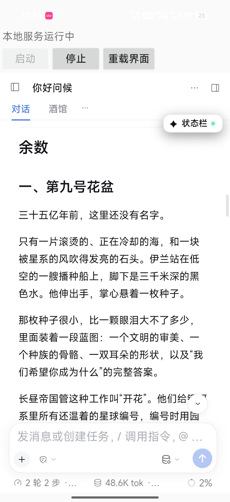

### 安装与模型费用

安装和校验无需调用模型。正文及启用的后台任务，按玩家选用的模型与渠道计费。联网和远程访问按需配置。[公网访问指南](PUBLIC-ACCESS.md)

## 开始体验

完成[一键安装](#一键安装)（或[手动安装](#安装)）并配置好自己的模型后：

1. **新建一个独立工作区。** 给这次角色扮演一个专用文件夹，角色卡、故事资源和导出文件都放在一起。
2. **在预设里选“角色扮演模式”。** 新建会话时从预设菜单切过去，就进入了你的故事工作台。
3. **上传角色卡，或者直接聊出一张新的。** 支持 SillyTavern / TauriTavern 的 PNG、JSON 人物卡；也可以只描述题材、人物、关系和氛围，让 AI 通过对话和你一起把这张卡做出来。
4. **开始体验。Enjoy it!** 跟着开场推进故事，输入你的行动，切换世界线，或随时打开“酒馆管理”调整设定。

没有现成角色卡，也可以从这样一句话开始：

> 帮我创作一张蒸汽都市悬疑角色卡。我想扮演刚到港口的调查员，故事慢热，有多方势力，也有人物关系的发展。其他细节你来决定。

告诉 AI 你想遇见怎样的人、经历怎样的故事。你可以一起打磨细节，也可以说“你来决定”，让它带着世界、人设、开场与文风继续创作。DOCX 等文档的读取方式见[文档扩展](#文档扩展)。手边只有一部长篇小说？也可以直接让它读成一张卡，见[长文本转角色卡](#长文本转角色卡)。

### 导入 SillyTavern / TauriTavern 人物卡

直接上传原始卡文件，然后告诉 AI：**“读取这张角色卡，准备开始角色扮演。”** 不用自己解码，也不用填导入工具的参数。

| 格式 | 支持范围 |
| --- | --- |
| **PNG 人物卡** | 从 `chara` / `ccv3` 的 `tEXt` 块读取 Base64 编码的角色数据；两者同时存在时优先读取 `ccv3`。 |
| **JSON 人物卡** | 识别 v1、v2（`chara_card_v2`）和 v3（`chara_card_v3`）。 |
| **内嵌世界书** | 读取 `character_book`，按当前导入流程审阅并映射到设定与世界书。 |

请选保留元数据的原始 PNG 卡：普通头像、截图或被移除元数据的图片里没有可导入的角色数据。PNG/JSON 解析是内置能力，不需要 anydoc；上传入口随完整安装提供。

导入完成后，从「从这里开始故事」选择开场。切到「酒馆」查看作者界面、状态栏和正文。原卡与扩展数据保存在资源库，可继续打磨人设、世界书和创作规则。

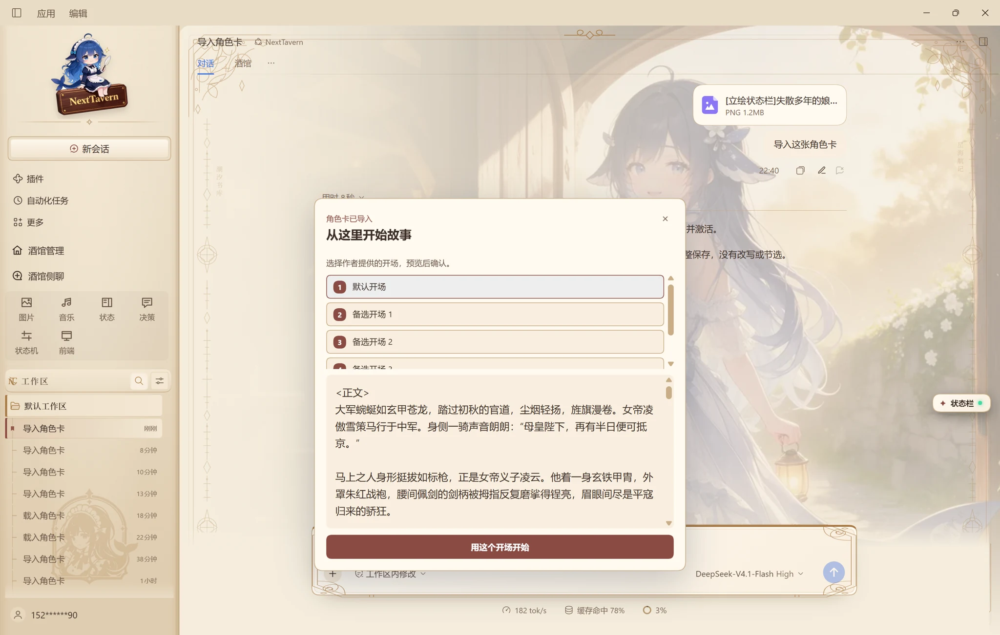

卡片里的三个文风字段会完整保留，怎么和预设配合由你决定，见[预设系统](#预设系统)。

## 核心能力

### 社区卡导入与作者开场

上传 SillyTavern／TauriTavern 的原始 PNG 或 JSON 后，酒馆保留原文件，也把人物设定、内嵌世界书、默认和备选开场、受支持的作者扩展带入当前会话。选择开场时，作者原文直接成为首条剧情，所选开场的初值与身份宏一并应用。社区卡没有接齐的扩展，可在导入报告查看。 [社区卡兼容指南](COMMUNITY-CARDS.md)


### 作者前端与交互

切到「酒馆」，可同时阅读正文和使用作者写的建角表单、状态栏或终端。0.3 在浏览器隔离环境执行作者 HTML、CSS 与 JavaScript，受支持的 Helper 接口可以把按钮操作接到剧情输入、变量、人物或世界书。卡内配图和音频依赖作者的资源链接。已识别的独立页面也能在「前端设置 → 作者悬浮窗」重新打开。 [作者前端与脚本范围](COMMUNITY-CARDS.md#5-模板脚本正则与页面分别做什么)

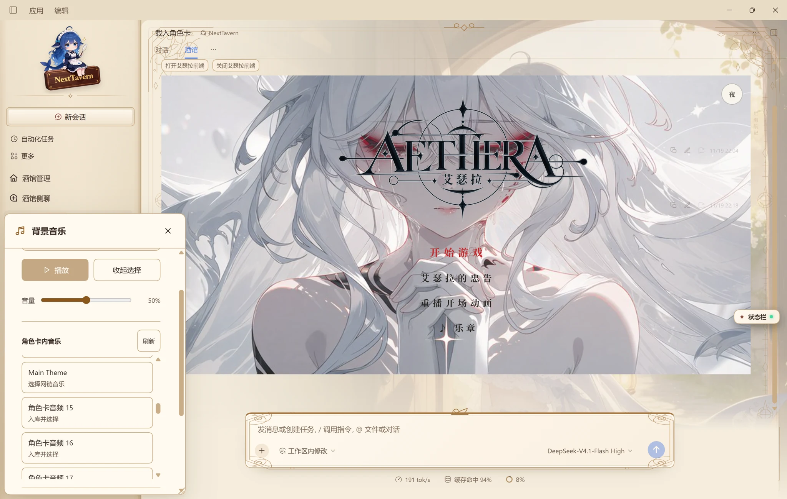

### MVU 数值状态机

以体力为例，卡片可以为不同开场设置不同初值，再用受支持的 MVU 更新协议和 Schema 让体力随行动变化。体力、物品和关系在剧情回合提交后进入下一轮。查看历史分支时载入相应切点的数值，重开时恢复已提交状态。玩家可在「状态栏 → 状态机」中查看「游戏数值」或手动保存变更。已结算的更新协议会从阅读正文与原稿导出中省略。 [数值初始化、更新与恢复](NATIVE-STATE.md)

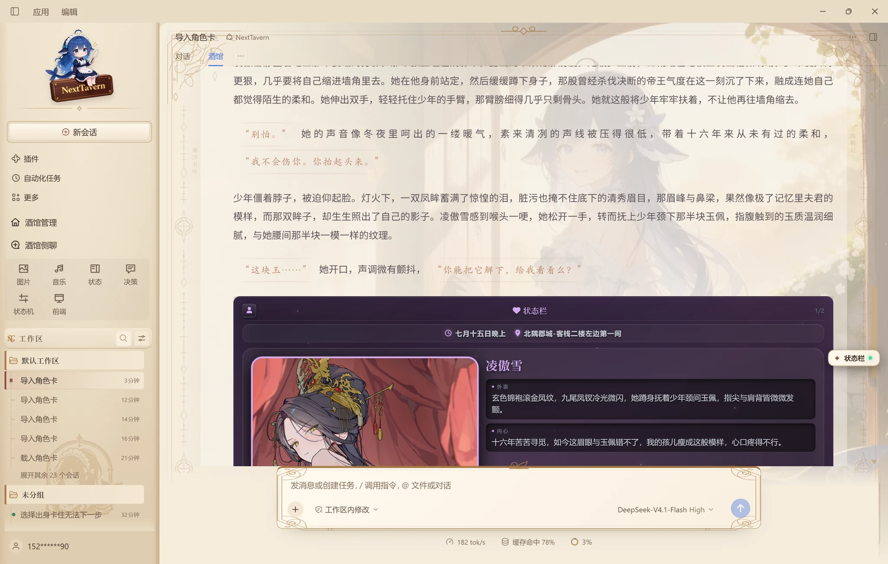

### Ruby 额外分析

支持卡内 `RubyAnalyzer` 配置。作者可设置开局任务、轮次、关键词、分析提示和输出目标。任务读取对应的剧情片段，成功的结果可写作聊天世界书材料，供后续剧情引用。玩家可以在「酒馆管理 → Ruby 额外分析」手动运行、切换方案或查看结果，分析使用独立模型任务。 [Ruby 调度与作者命令](NATIVE-STATE.md#6-ruby按周期产生分析材料)

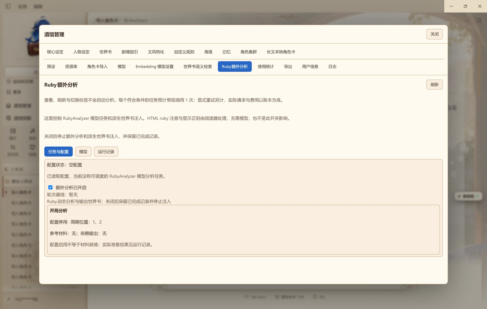

### 结构化世界书与 EJS

「世界书」可导入独立 SillyTavern JSON，也可编辑随角色卡导入的结构化条目。一本书可绑定到全局、角色或当前聊天。作者可以让资料常驻、按关键词触发、递归关联，并设置顺序、注入位置与预算。受支持的 EJS 模板可以在准备剧情时按条件读取变量和世界书，生成这一轮才需要的文本。 [世界书触发与注入](COMMUNITY-CARDS.md#4-世界书怎样进入本轮剧情) · [EJS 作者模板](NATIVE-CARD-FORMAT.md#8-ejs-作者模板动态文本与世界书联动)

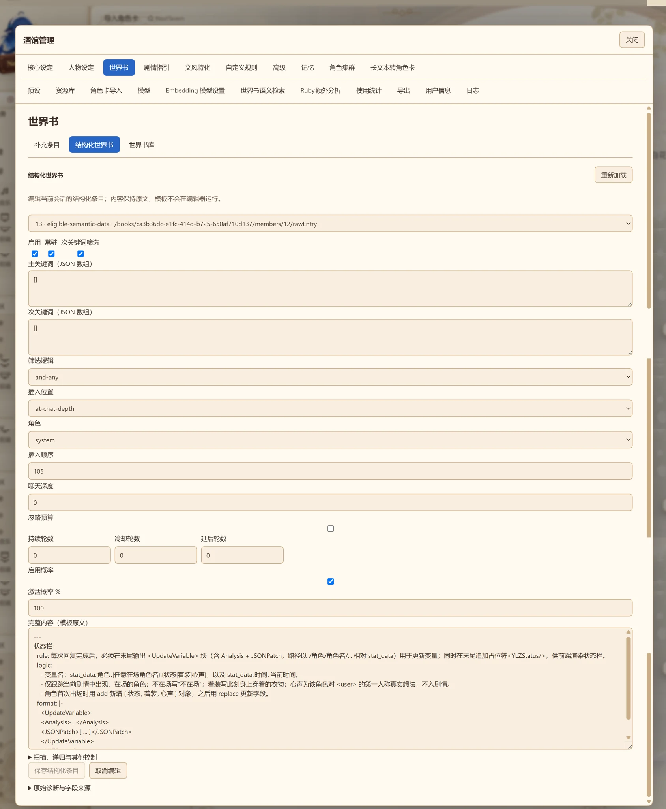

### 社区预设与正则

「预设」可导入社区 JSON，管理条目内容、顺序、功能组、宏变量、送入请求的历史和正则。预设可全局应用，也可为指定对话选择，采样参数独立开启。创作文风仍可选系统、混合或角色卡文风。请求正则改变发给模型的材料，显示正则改变读到的样式，历史原文继续用于追溯。 [社区预设与正则指南](COMMUNITY-PRESETS.md)

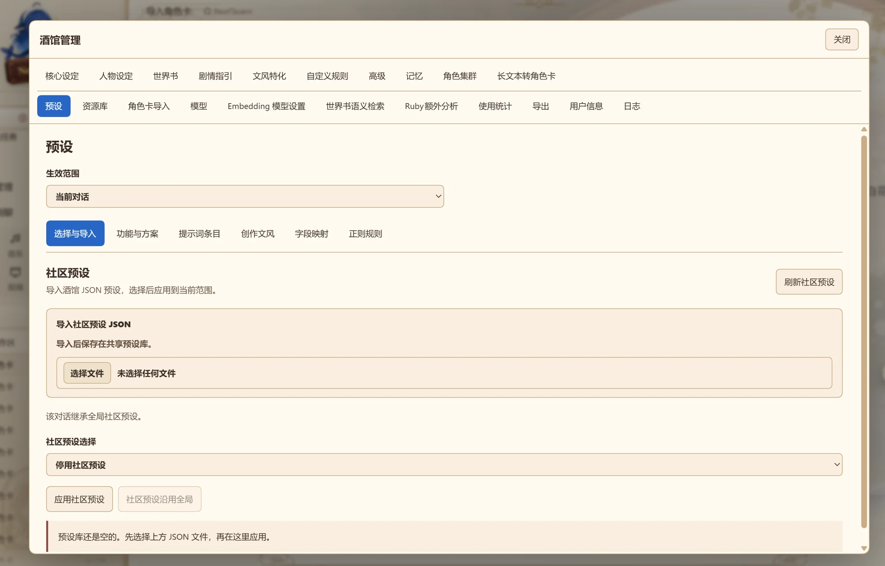

### 原生创作、世界线与侧边聊天

**Native 1.2** 将人物、开场、世界书、规则和作者配置写在同一份作者文档里。可从对话创作、导入资料或长文本改编，保存后导出当前卡到新会话；最初上传的原件也可单独取回。[交互式创作](#交互式创作) · [两张完整作者参考卡](preset/reference/README.md)

**侧边聊天**能参考当前人物、世界书、有效剧情与数值。可以讨论下一幕，也可以明确要求保存设定修改，再回到主剧情续写。重生成或分支时，状态和记忆随各自的世界线。可把选定世界线的正文导出为小说稿。 [世界线与分支](#世界线与分支) · [小说与卡片导出](#从角色卡到可带走的小说)

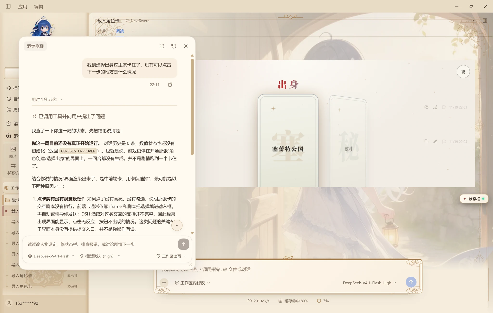

### 长篇工具

| 能力 | 入口 |
| --- | --- |
| **记忆与检索** | 固定设定、近期完整正文和可追溯的导演笔记组合进上下文。关键词、语义和混合搜索按需召回旧情节，导演笔记与剧情检索使用正文材料。 [记忆系统](#记忆系统) · [嵌入模型](#嵌入模型) |
| **人物各自推演** | 为主要人物安排独立模型或记忆视角，在「角色集群」查看和修订资料，并按需开启场外推理。 [角色集群](#角色集群) |
| **模型、阅读与用量** | 为正文、记忆及其他任务选择模型，查看请求、缓存与已知成本。支持酒馆皮肤、状态栏与决策卡。 [用量统计](#用量统计) · [状态栏与决策卡](#状态栏与决策卡) · [自有皮肤](#全新自有皮肤) |
| **安装、改编与资料** | 官方插件安装和 Windows／Linux 便携方案。长文本可精读或粗读转成卡，原件和导出文件都能在资源库取回。 [一键安装](#一键安装) · [长文本转角色卡](#长文本转角色卡) |

## 记忆系统

故事越写越长，人物的经历、埋下的伏笔和未完成的约定也在积累。NextTavern 借鉴 Codex 类长任务的上下文管理思路，把长篇记忆拆成四件各有边界的事：**固定设定不压缩始终注入 + 有尾部保留的上下文硬切窗口 + 可追溯来源的后台导演笔记 + 关键词和语义混合历史上下文查询召回。**

| 支柱 | 它做什么 | 写长篇时有什么用 |
| --- | --- | --- |
| **固定设定不压缩，始终注入** | 冻结的设定与系统前缀每轮都在场，从不进入压缩流程。 | 身份、作者规则和叙事约束是长期契约，不该被一段摘要替换掉。 |
| **硬切窗口 + 尾部保留** | 程序按完整正文边界推进上下文窗口，并在推进时保留尾部连续正文。 | 近期正文保持完整细节，你正在读的那一段不会因为切窗口而丢失，也不会在场景中途被摘要掉。 |
| **可追溯来源的后台导演笔记** | 由独立的后台任务撰写，每条笔记带来源哈希与同一世界线锚点。 | 每条笔记都能追回到写出它的那段正文；追不回来的旧记录会留在原处，程序不会替它猜。追加式原始历史从不删除。 |
| **关键词和语义混合的历史召回** | 主代理按需查询历史，三种方式：**关键词（默认）／语义／混合**。 | 需要旧细节时再回查原文，而不是每轮都先强制召回一次。 |

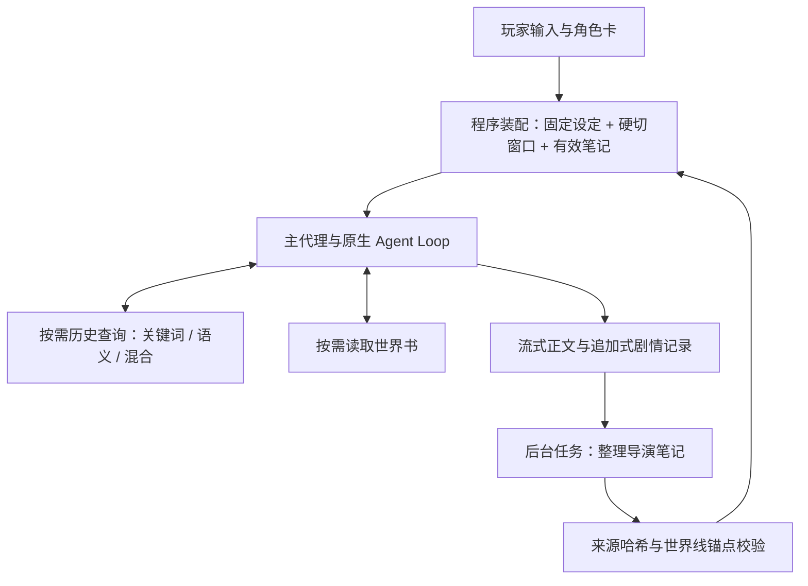

### 三种查询方式，同一份语料

查询的语料是**玩家输入与有效剧情正文**，包含已经归档或被淘汰的正文；状态、工具输出、CSS、决策卡和推理过程都不会进去。

| 方式 | 谁来算 | 什么时候用 |
| --- | --- | --- |
| **关键词（默认）** | 程序确定性匹配，不调用模型。 | 想找明确的词句、人名、地名时最快。 |
| **语义** | 需要嵌入模型把查询编码成向量。 | 只记得大意、不记得原话时更有效。 |
| **混合** | 关键词与向量结果一起排序。 | 兼顾精确命中与语义相近。 |

向量是派生的共享数据，查询时会过滤到**当前世界线**，所以切换世界线不用重建索引。每份向量索引都带一个配方指纹（模型、修订、维度、任务角色、池化方式、量化与运行时）：指纹对不上时，索引会被标记为 `stale` 并停止对外服务，直到你重建为止——它宁可让你重建，也不会拿旧向量凑出错误答案。分块大小全局可配置，默认 480 字符（192／480／960 三个选项，128–2048 区间，80 重叠），本地模型使用 512 的分词预算。清空、重建与填充都限定在当前可见对话及其全部世界线；清空只清索引，正文、来源和账本都留着。

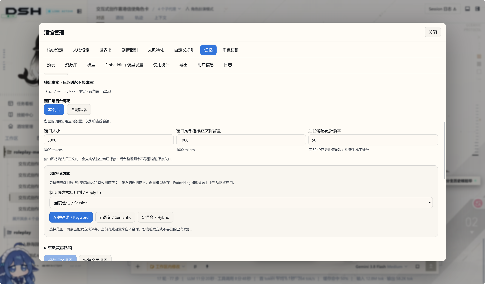

### 旧笔记与旧状态不再随每次请求发送

旧导演笔记与旧状态快照以前会跟着每次请求一起走（约 52k 字符）。现在它们只在**有效的新锚点准备好之后**才被替换：没被替换的引用保持原本的精确内容，回滚时重新提供完整文本，原始事件始终是追加式的。写长故事时，请求里不会一直拖着越来越重的旧笔记。

同样的“先确认再替换”也用在很长的工具结果上：一条研究笔记被确认后，对应的长工具结果会被替换成匹配的检查点，前提是归属、来源哈希、generation 与 packetIds 全部一致。部分保存、来源不符、写入失败，以及确认之后又重读过的情况，都不会回收。

### 这些都可以按会话调整

窗口大小、尾部保留量和后台笔记更新频率支持全局默认与会话覆盖，留空就沿用全局设置。截图里能看到的一组实际取值：

| 设置 | 含义 |
| --- | --- |
| **窗口大小** | 当前窗口的正文预算，按你实际使用的模型上下文容量来配。 |
| **窗口尾部连续正文保留量** | 切窗口时必须留住的近期正文，保证你正在读的那一段完整。 |
| **后台笔记更新频率** | 每多少个新增正史剧情轮次整理一次；重生成不计入。 |
| **记忆检索方式** | 关键词／语义／混合，以及应用到哪些会话。 |

切换检索方式不会删除已有索引。窗口即将淘汰旧正文时，会先确认检查点已保存；后台整理频率不会取消这道保存关口。

窗口装配、来源校验、笔记淘汰和原文回收都由程序完成，不产生模型请求。只有主代理真的决定去查历史时，才按你选的方式付出一次查询代价（语义与混合还需要嵌入模型，见[嵌入模型](#嵌入模型)）。

换一条世界线，就带着那条路线的经历继续向前；反复打磨同一幕，记忆会跟随你选中的版本。章节交接前，系统会先把需要延续的故事线索整理妥当。

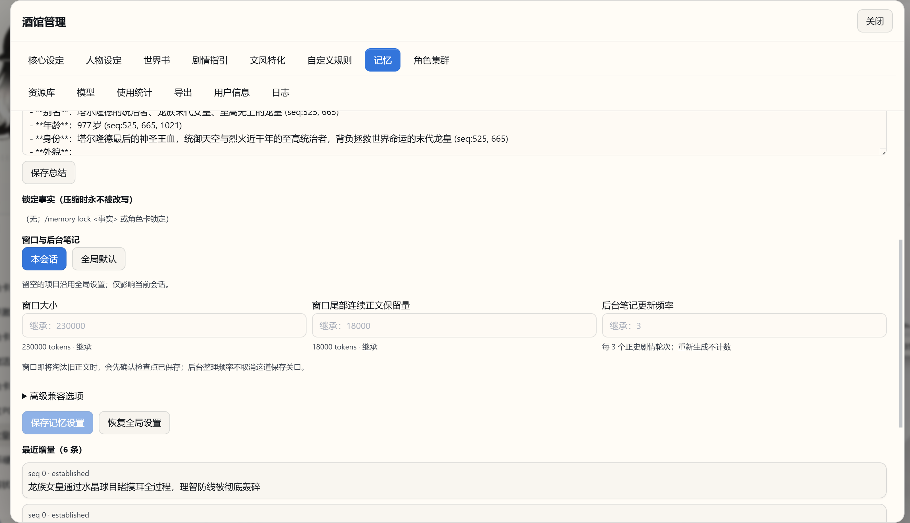

## 预设系统

文风不再只能靠改卡片。管理界面里多了一页独立的**预设页（位于资源库之前）**，可以新建、编辑、另存副本、选用和删除；自带预设是只读的，自定义预设给你 200 个槽位。

| 维度 | 可选值 | 含义 |
| --- | --- | --- |
| **作用范围** | 当前对话／指定对话／全局 | 同一对话的全部世界线共享这次覆盖；留空就沿用全局设置。 |
| **文风模式** | 前景系统美学（默认）／与卡片文风融合／仅卡片文风 | 前两种同时注入预设与卡片文风，冲突时预设优先；第三种只使用卡片文风。 |

预设库由所有对话共享，所以编辑一个正在被使用的预设，会影响使用它的对话后续生成——界面会明确提示这一点。要是两个窗口同时改同一个预设，后提交的一方会收到冲突提示，**你的草稿仍然留着**，不会被悄悄覆盖。

卡片导入、编辑、导出与持久化都保留三个卡片文风字段，排除只发生在故事上下文装配阶段，原始卡片不会被改写。

**自带 16 种文风。** 除了默认预设和空白预设，还准备了 14 种可直接选用的写作风格：日式轻小说、乙女风格、三体文风、日式游戏、电影感文风、春秋文风、极简文风、细腻文风、奇幻网文风、恐怖文风、鲁迅文风、抒情文风、日常搞笑风、古文文风。每一种都有完整的七段式指南和原创示例，不是只有一句风格描述。

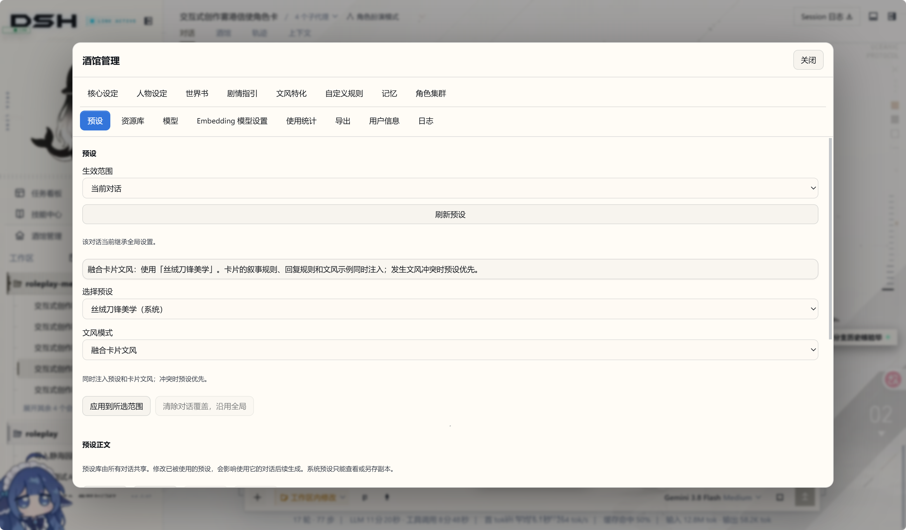

<details>
<summary>查看自带文风预设库</summary>

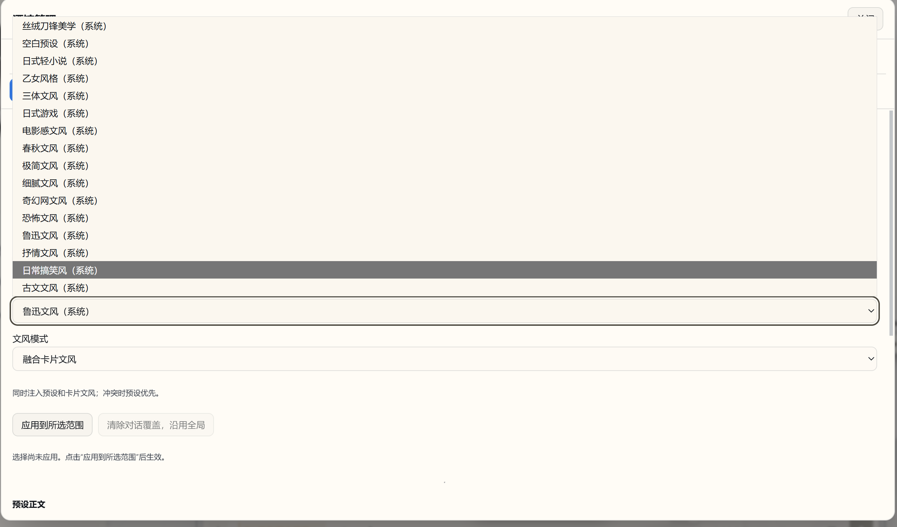

</details>

## 长文本转角色卡

手边有一部长篇小说，想把它变成能玩的世界？管理界面里多了一个**「长文本转角色卡」TAB（位于角色集群之后）**。它做的不只是总结：**读过什么、笔记记在哪、卡片里的话有没有原文依据，都要能对得上。**

**两种阅读方式，在研究开始前选。**

- **精读（默认）**：分段逐段完整阅读，每一段都留下带原文引证的研究笔记。
- **粗颗粒度**：围绕人物、组织与事件面做多轮关系前沿检索，再做主角的纵向追踪。它**需要**一个可用的小说模型和完整的当前索引；条件不满足时，界面会引导你先把配置补上并结束本轮，不会悄悄降级成另一种模式。

**原文先冻结。** 工作区 TXT 上限 64 MB，按 UTF-8 → GB18030 → 带 BOM 感知的 UTF-16 依次尝试解码，记录原始字节哈希、解码文本哈希与大小，并且从不修改你上传的原文件。分段是确定性的，批次大小被限制在原生切分器之下。

**笔记要有证据。** 一条研究笔记要成立，得同时满足两件事：这一批确实被读过，引用的原话也确实出现在这一批里。笔记分事实／改编机会／未决问题三节；只在检索里命中，不算这一批已经被读过。

**小说有自己的索引。** 它和故事记忆的语义索引分开，小说模型也可以与故事记忆模型分开配置。相同的原始哈希复用研究基线，相同配方复用向量——同一部原著可以服务多张卡、多个对话。

举个例子：一部约 119 万字符的长篇网络小说（前 354 章）建立了 3027 条在线向量，程序为等待索引完成挂起约 292 秒；交付角色卡与打开导入是两个独立回合，开场输入约 52k tokens。改编复用与交互式创作相同的问卷和十二项写卡检查。

开发线在研究完成后使用与原创写卡相同的 Native 草稿与共同定稿入口，保留原文和研究依据。已有清晰的人物／规则栏目由程序直接导入，不为格式再分类一次；阅读、检索和创作本身仍按实际模型任务计费。

小说很长时，个别细节仍可能写错，成稿后建议自己通读一遍。

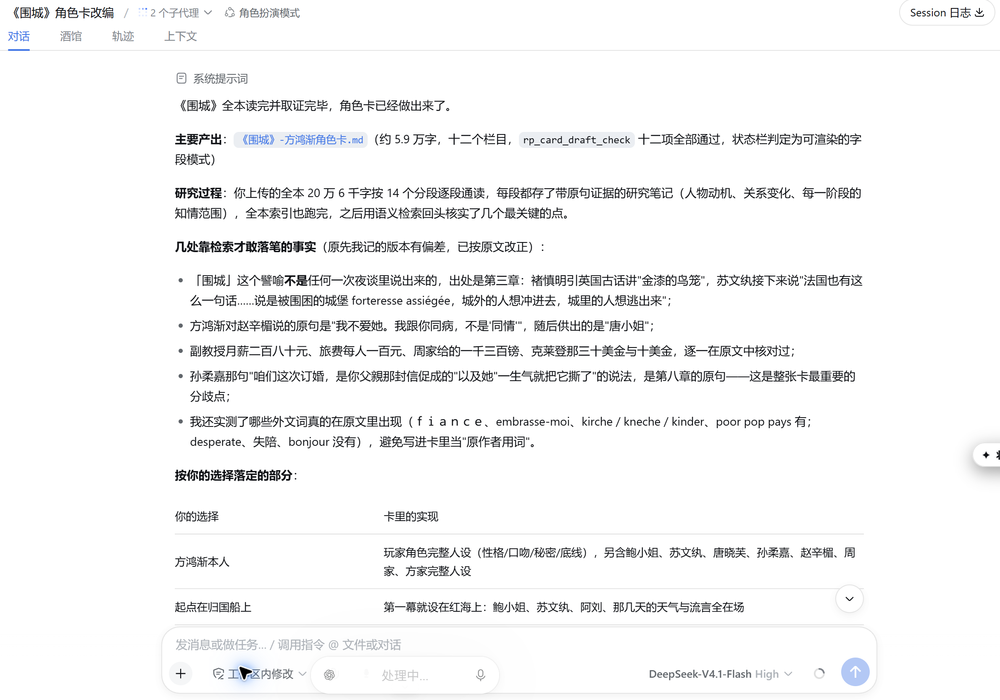

## 嵌入模型

语义与混合检索需要向量，所以管理界面里多了一页独立的**嵌入模型页（位于模型与使用统计之间）**。

**在线接入。** 支持 DashScope、OpenAI 兼容接口和 OpenAI 官方：模型列表可刷新，也可以手动填写模型 ID，密钥只保存在服务端，并提供连接测试。

**本地接入。** 五种本地模型可以直接装：**BGE small zh、Qwen3-Embedding 0.6B、Jina Nano、Jina Small INT8、Nomic q8**，在独立编码进程中使用 ONNX Runtime 1.29.0 运行。下载显示真实字节进度、速度与预计剩余时间，支持暂停／取消／继续，并有 `queued → downloading → verifying → preparing-runtime → self-testing → installed` 的安装状态机。**本地推理不需要 API Key，也不需要网络。**

真实的索引／查询／测试／重试都会进入既有的用量统计。未知价格保持 **N/A**，失败不会虚构 token 数。

选哪个？BGE 快，跨语言能力弱一些；Qwen 在长正文上建索引更慢；分块到 5 万条时，检索时间已经接近上限。

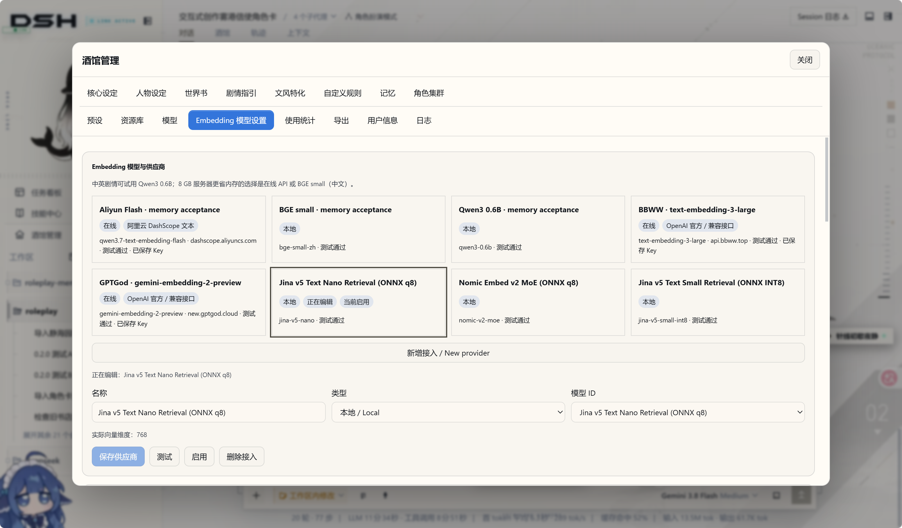

## 角色集群

开启**角色 Agent 集群**后，主要人物分别在独立上下文中推演。每个角色可以选择模型与思考强度，即使用同一个模型也独立运行。它们获得自己的人设、当前剧情、导演笔记和近期已读取的世界书资料，主代理再综合各方建议推进故事。

开发线区分清晰的作者人物栏目与需要分类的社区混合资料。前者可直接读取人物，后者通过玩家选择的转换任务建立原文关联；玩家与禁用人物不进入 NPC 列表。高级资料复用本轮实际准入的世界书和已渲染材料，部分混合动态规则仍有使用限制，不能因转换显示就绪就认定全部玩法都适用于人物协作。

模型配置分两级：**全局默认模型 + 单角色覆盖**。单角色覆盖属于当前可见对话，并与其世界线共用；但每个实际世界线的输入与结果仍然互相隔离——共享的是偏好，剧情历史各写各的。

后台的子代理不会再出现在会话列表里；保存草稿、资源与导出回复、任务操作也不会再重复提交或过期。

想让一场相遇拥有更多角度，就为这段故事开启角色集群。让每个人物带着自己的性格、立场和打算参与推演，再由主代理把碰撞与交锋写成一幕完整的戏。

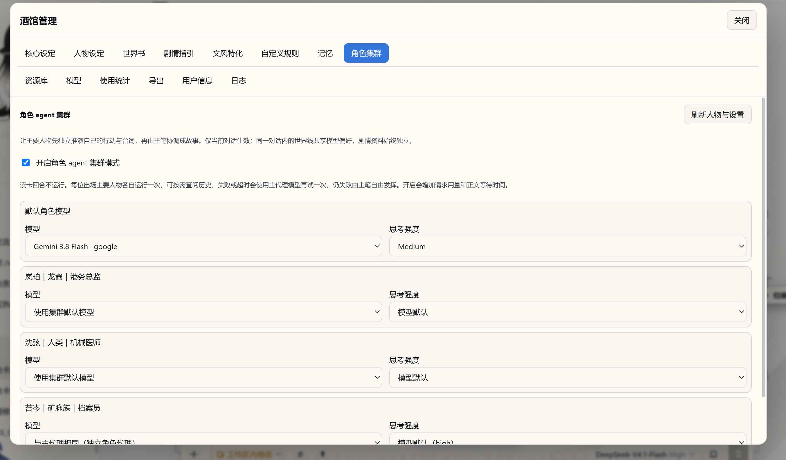

**人物各自推演之外，模型也可以分工。** 你可以让正文、后台记忆、读卡、状态与导出任务使用适合的模型，也可以统一跟随主模型；模型设置支持全局默认和当前会话覆盖。

<details>
<summary>查看多模型协同设置</summary>

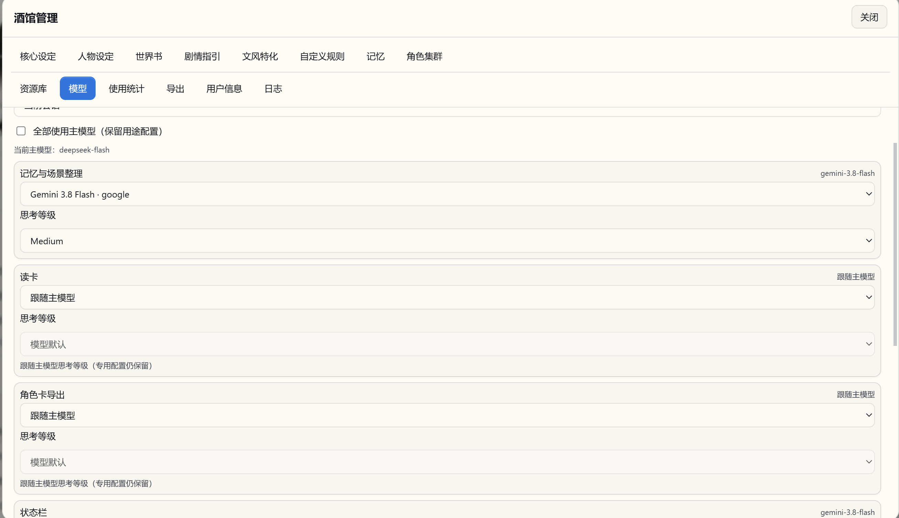

</details>

### 慢速本地聊天模型的首响应等待

如果本地聊天模型生成首个响应较慢，可在现有角色扮演预设中为 `roleplay-core` 的配置设置可选项 `firstResponseTimeoutMs`；默认值是 **90000 毫秒（90 秒）**。例如把它设为 `600000` 可等待最多 10 分钟。此项只延长现有请求等待首个响应的时间；`workerMaxTokens` 是输出 token 上限，不是时间设置。

配置应放在当前产品配置 `addons[id=preset-roleplay].config.plugins[id=nexttavern-roleplay-composition].config.patches[id=roleplay-core].config` 中，不要放在产品根 `config`。下面展示了本版本实际 `roleplay-core.config` 值，并加入 10 分钟示例。它只代表 composition 子行，不是可替换 profile 的完整配置；编辑自己的预设时，请保留该行现有的全部值，只增加需要的字段：

```yaml
# 编辑 addons[id=preset-roleplay].config.plugins 中已有的 composition 子行
- id: nexttavern-roleplay-composition
  name: dsh-nexttavern-presets/composition
  config:
    patches:
      - id: roleplay-core
        name: './lib/core/roleplay-core.js'
        config:
          sceneWorkerTimeoutMs: 60000
          memoryWorkerTimeoutMs: 60000
          phaseATimeoutMs: 90000
          phaseBTimeoutMs: 120000
          maxWorldTokens: 6000
          windowTokens: 24000
          concurrencyCap: 2
          workerTemperature: 0.4
          workerMaxTokens: 2048
          firstResponseTimeoutMs: 600000
```

新配置由新的 preset revision 使用；已有会话仍固定使用已挂载的 revision，确认设置时请新建会话。作者分享的一次 27B 本地模型试验使用了 96k 上下文并启用 reasoning；这只是单次经验，不是所有模型的最低要求。`windowTokens` 应符合所选模型实际支持的上下文长度，reasoning 选项依模型而异。

## 状态栏与决策卡

**行动建议只出现在独立决策卡里**，不再重复塞进状态栏或正文尾部。旧卡片里遗留的行动区域会被隐藏，但原卡本身一个字都不改。

决策卡现在有自己的操作：**折叠／恢复（⌃ / —）**、独立的 **× 稍后处理**、拖动移动，双击或按 Home 复位，可视高度有上限，不会吃掉整个屏幕。

阅读呈现也顺手顺了一批：作者写的状态 HTML/CSS 在导入、生成和旧数据恢复三条路径上都会被校验并保留；围栏状态样式与不透明面板恢复；状态面板撑满可用高度同时保留内部滚动；折叠后的侧栏重新展开按钮保持可见。状态模板的动态槽位可以接收真实数值，同时保留作者原有的 HTML/CSS/JS 结构；任务校验失败会带上结构化诊断、失败时间和重试指引。

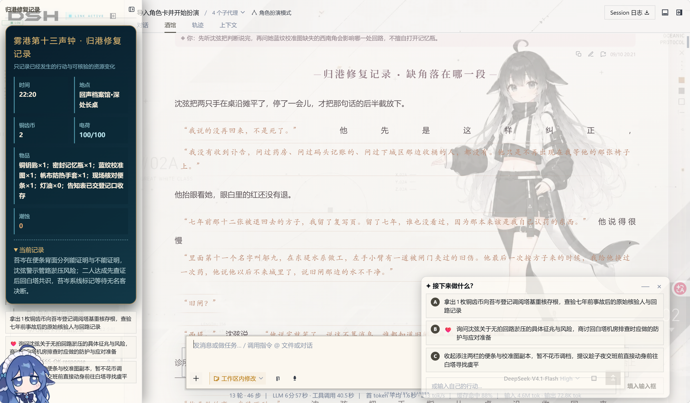

## 全新自有皮肤

0.3 随包提供暖纸、NT 徽记和昼夜主题的自有琥珀皮肤，首次安装后可在设置中选用。

项目提供**第一套自有皮肤 `dsh-nexttavern-amber`**：整套界面用同一套设计 token 重绘，**日间与夜间两套主题**切换一次就是两种气氛；侧栏坐着一位 Q 版酒馆看板娘，日夜各是一张不同的画；夜间主题下的酒馆阅读模式铺在陈旧羊皮纸上，作者自己写的墨色一点没动——喜欢安静地读完一篇长文的人，会喜欢这一版。

皮肤随安装包一起装好，但**默认不开**，所以你的界面还是原来的样子。想换上它：打开 **设置 → 插件市场 → 已安装**，找到 `dsh-nexttavern-amber`，把开关打开。它写进 profile 的 `cordis.patch.yml`，热加载大约一秒生效，**不用重启**；看腻了拨回去就行，你的选择在重启后依然保留。这个开关由第三方插件市场提供；已有市场会复用，缺少时才由产品安装上游市场，来源、出站请求与关闭方法见[补丁与依赖来源](#补丁与依赖来源)。

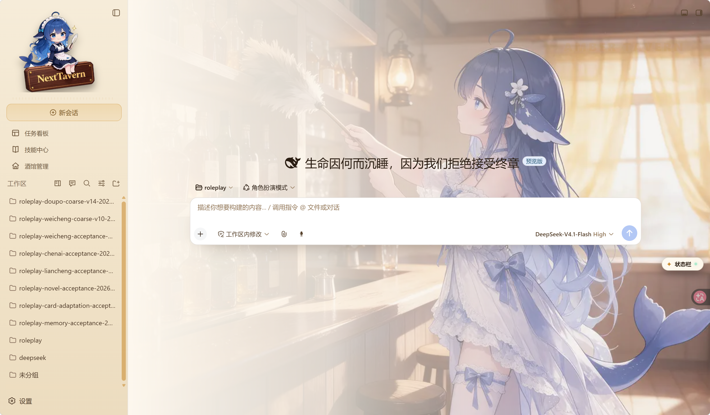

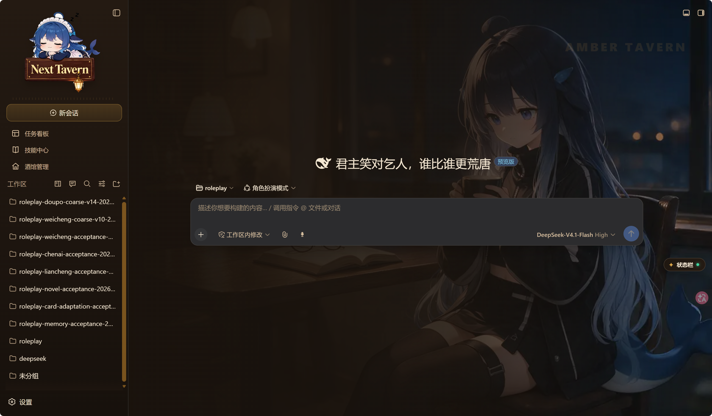

## 世界线与分支

不满意某段发展，可以重新生成；想改一个选择，可以修改玩家消息后发送。不同版本组成当前对话内的世界线，可以来回切换查看。只有在显式选择“在新对话中分支”时，才会创建独立对话。

每条世界线有自己的剧情、状态与记忆；笔记属于实际世界线，而角色的模型偏好与向量索引按对话或查询世界线共享。小说导出跟随你选中的世界线，方便保留你喜欢的故事版本。

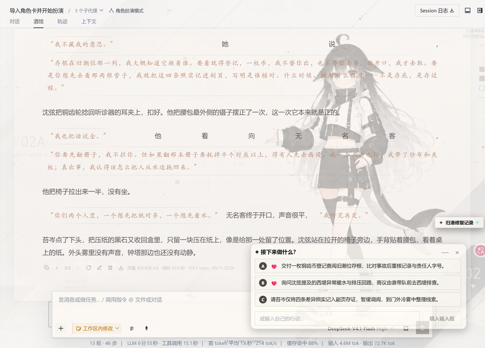

## 按你的方式阅读与创作

在“酒馆管理”中分别调整人物、世界背景、剧情方向、文风和自定义规则。把镜头、节奏与人物边界写进规则，把 HTML/CSS、状态栏和正则美化写进卡片，让不同故事拥有不同的阅读呈现。

正文生成时就能读；局后状态与笔记维护有独立进度。继续输入的玩家行动进入原生队列。

作者可以用卡内的显示正则和样式为正文排版。状态栏沿用作者自己的模板，可把好感度、信赖度或场景时间显示在剧情旁。[预设与正则](COMMUNITY-PRESETS.md) · [原生状态与分析](NATIVE-STATE.md)

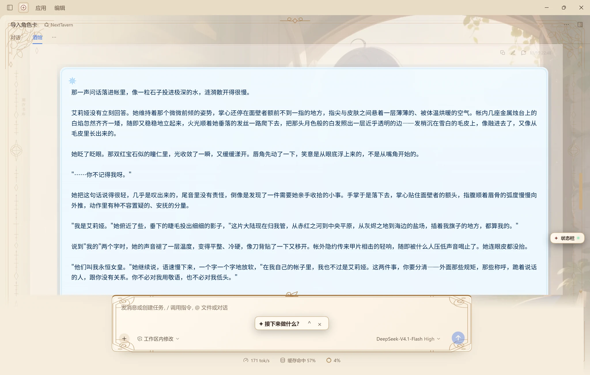

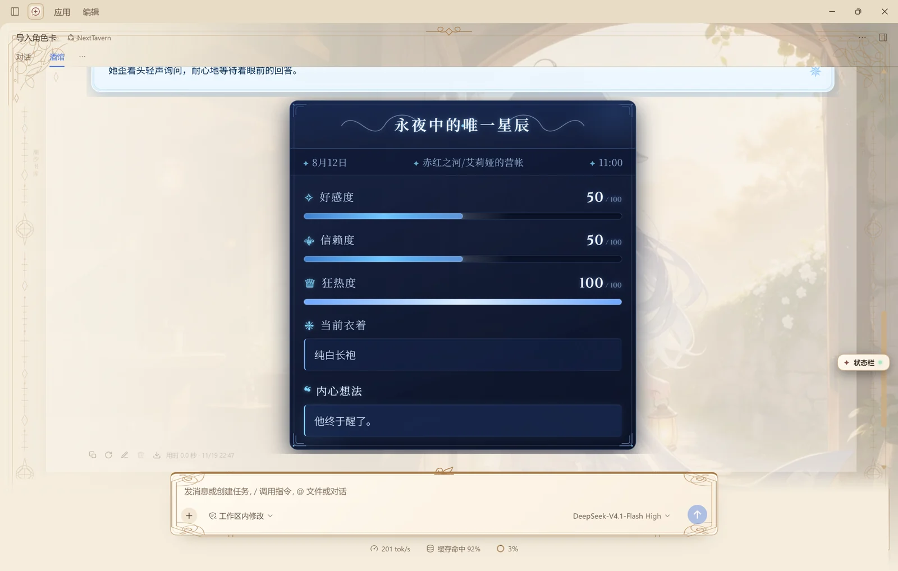

<details>
<summary>查看管理界面、自定义规则与世界书</summary>

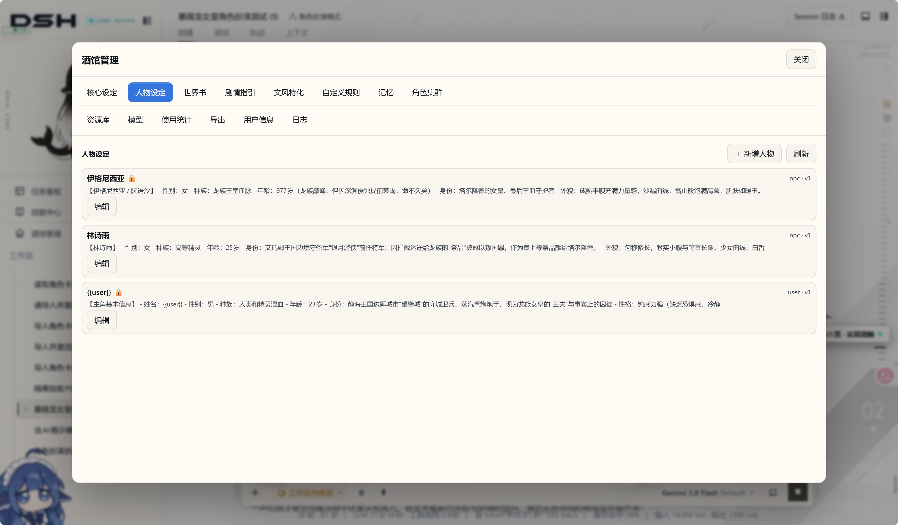

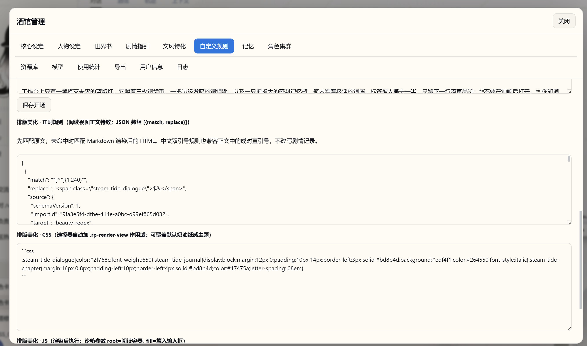

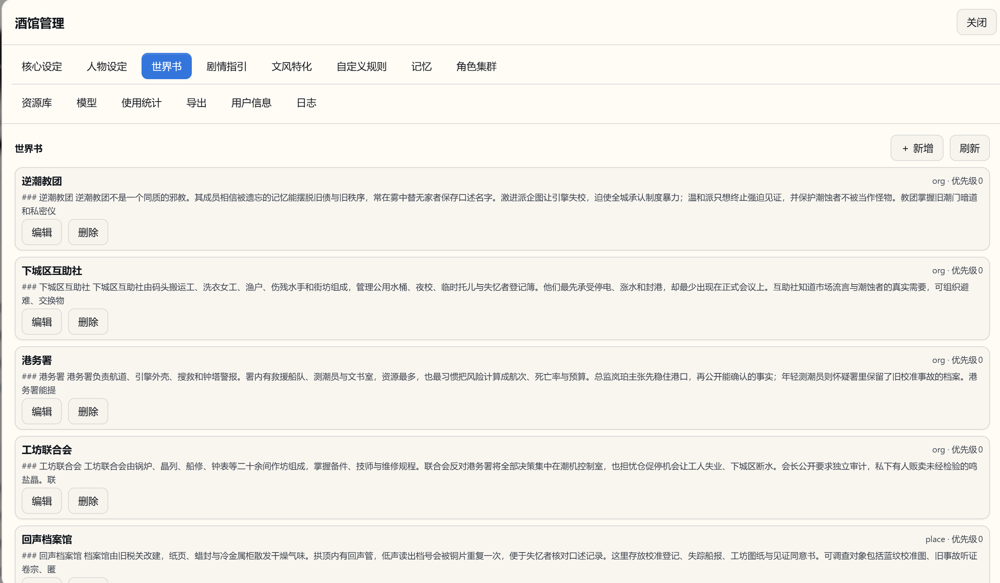

</details>

## 从角色卡到可带走的小说

那些反复推敲的对白、意想不到的转折、终于抵达的结局，都值得成为一份真正的作品。选中你喜欢的世界线，一键整理成小说稿；也可以导出打磨后的完整角色卡，让这个世界继续被阅读、被分享、被创作。

开发线的当前卡导出包含已保存的人物、规则与作者配置，包括已保存的 Ruby 方案选择；下载上传原件则保留原字节和文件名。卡片、小说与完整会话备份各有用途：卡片承载设定，小说承载选定故事，世界线历史与运行进度另行保存。

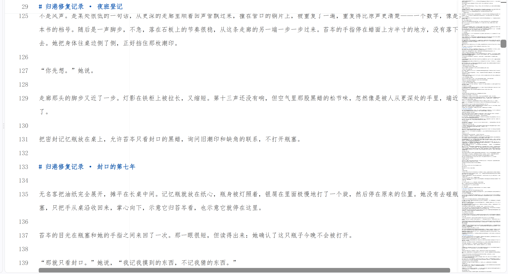

<details>
<summary>查看资源库</summary>

资源库按时间或名称排序，支持刷新、查看文件与下载；角色卡和导出文件保留可识别的主题名称。

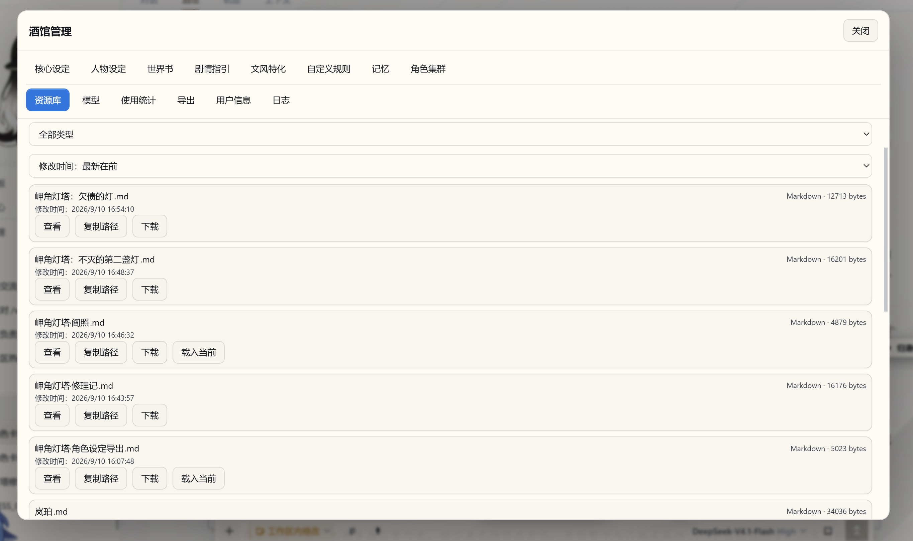

</details>

## 交互式创作

**不必先准备一张完整角色卡，带着想象力来就够了。** 一座永远下雨的港城、一段针锋相对的关系，或只是“我想经历一场慢热的冒险”，都能成为创作的开端。

AI 会和你聊人物、关系、氛围与剧情方向，把你的回答逐步展开成世界背景、多角色人设、开场、文风和阅读排版，再用十二项完整性检查过一遍。你可以亲自雕琢每一处细节，也可以把留白交给它：“你来决定。”从最初的灵感到可以开玩的角色卡，创作本身就是旅程的一部分。

开发线的写卡与完成研究后的小说改编共用一份 Native 作者草稿和定稿入口。草稿检查不激活卡；你已明确要求应用时再保存并进入导入流程，否则先交付文件。明确的人物与规则栏目不需要额外分类模型，定稿也不会自动多写一条开场。格式、脚本与展示仍需按作品实际配置检查，详见[作者教程](NATIVE-CARD-FORMAT.md)。

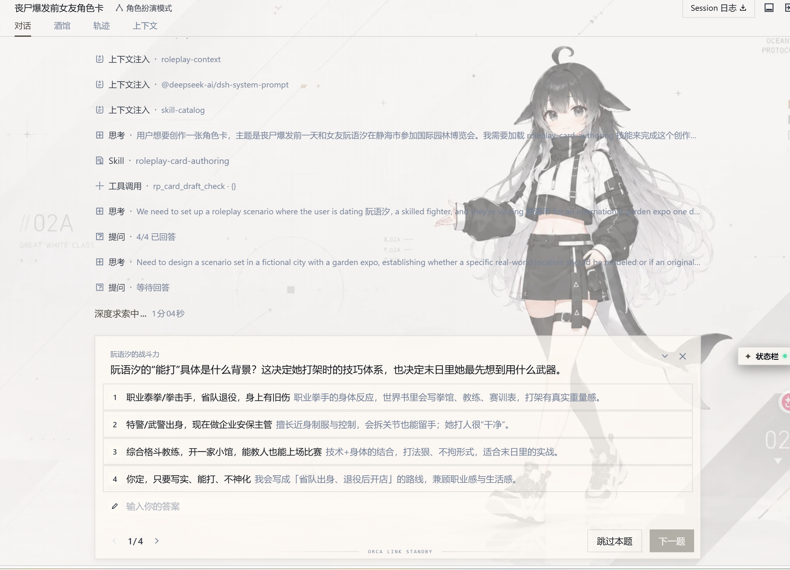

## 用量统计

**尽情探索，也把模型的表现与开销看清楚。** 请求日志、供应商统计和模型统计集中在同一个面板，按会话、时间与模型切换，就能查看输入输出 tokens、缓存命中率、生成速度和费用。嵌入模型的索引、查询、测试与重试也计入同一份统计。

比较不同模型的创作投入，观察长篇推进时的缓存变化，回看一次重生成或角色集群调用的消耗，都有据可查。支持模型价格倍率、手动单价与币种换算，让你按自己的预算与偏好安排下一段故事。

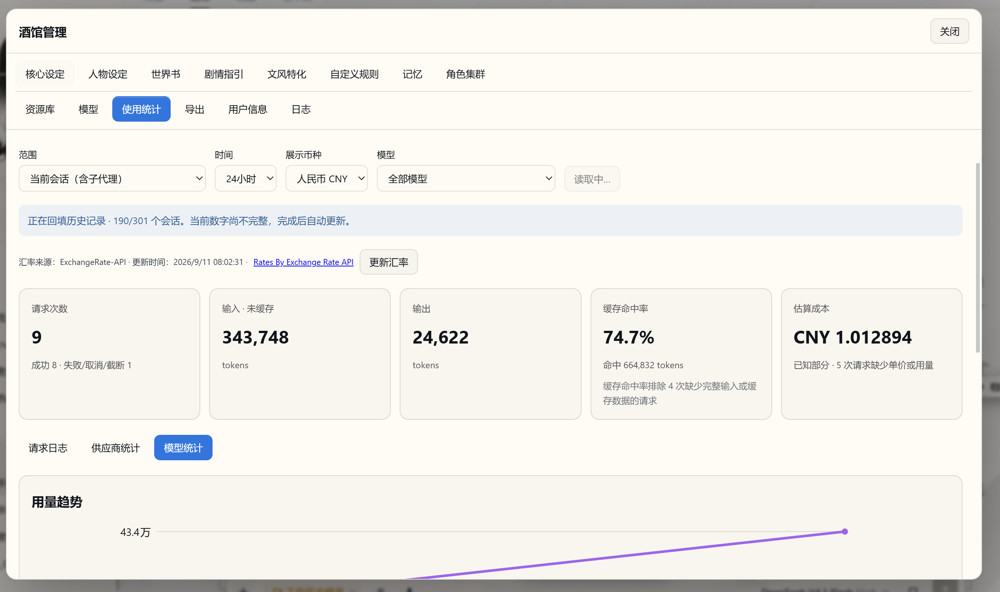

## 架构设计

**功能都在上面了，这一章说它们在同一套运行时里是怎么接起来的。** 写长篇，需要沿途积累的记忆、可随时翻阅的世界资料，也需要人物各自的动机。NextTavern 将这些能力连接进原生 Agent Loop：**主代理推进叙事，记忆代理整理长线，角色代理独立推演，程序把当前故事需要的上下文准备好。** 从读卡、开场到分支与导出，整个创作过程由这套架构贯穿。

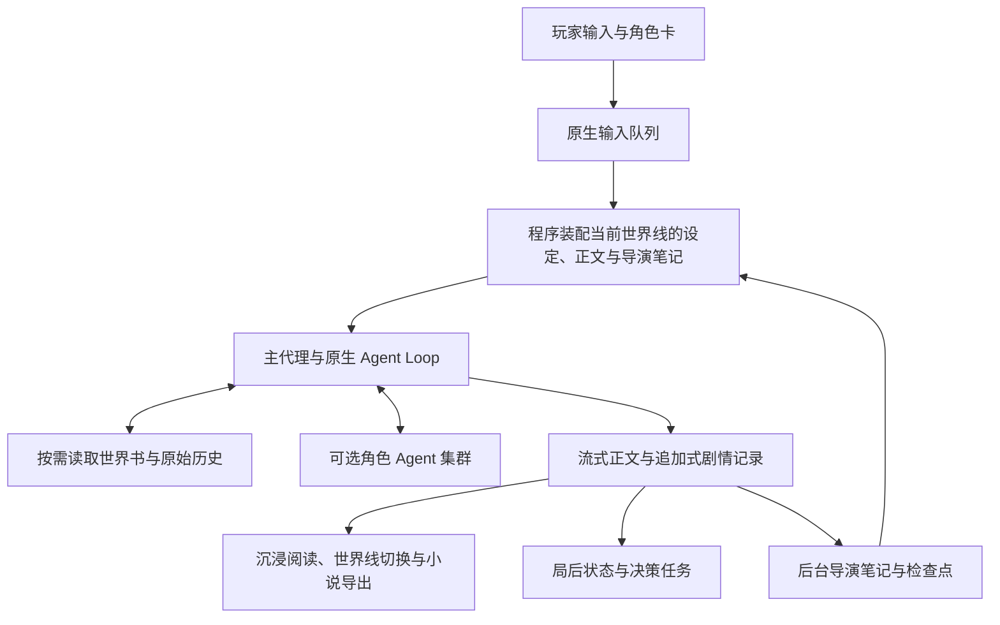

五个设计，贯穿你的每一次创作：

1. **让 AI 主动探索世界。** 当前设定、正文和笔记随时可用；需要世界知识或早期细节时，主代理自己查阅资料，再把发现融入故事。
2. **给长篇一套会整理的记忆。** 固定设定始终在场，近期正文保留眼前细节，导演笔记承接长线，历史查询让旧事有迹可循。从当前场景到早期伏笔，信息各有归处。
3. **把“换一种选择”变成真正的世界线。** 重写一句行动，重新生成一次回应，就能沿另一条路线继续。每条世界线保留自己的剧情、状态与记忆，也能单独导出。
4. **让不同角色带着自己的想法登场。** 角色分别推演，主代理综合他们的行动与意图；记忆、状态、读写卡等工作还能交给不同模型协作完成。
5. **让阅读跟上灵感。** 正文边写边读，状态与笔记随后整理。你可以继续酝酿下一步行动，让创作自然衔接。

[阅读完整架构说明：上下文组成、记忆四支柱、预设作用域、长文本流水线与请求成本](ARCHITECTURE.md)

## 下载

**架构说完，下面是取用与维护这一版需要的材料。** 发布资产如下。

- [主包 dsh-nexttavern.tgz](https://github.com/a86582751/dsh-nexttavern/releases/download/v0.3.0-rc.1/dsh-nexttavern.tgz)，含统一插件、预构建 UI、preset、参考卡与运行依赖。
- [独立 dsh-debug.tgz](https://github.com/a86582751/dsh-nexttavern/releases/download/v0.3.0-rc.1/dsh-debug.tgz)。
- [公网鉴权插件 dsh-auth-webserver.tgz](https://github.com/a86582751/dsh-nexttavern/releases/download/v0.3.0-rc.1/dsh-auth-webserver.tgz)，安装步骤见[手机电脑公网访问指南](PUBLIC-ACCESS.md)。

一键安装器：

- [NextTavern-Setup.exe](https://github.com/a86582751/dsh-nexttavern/releases/download/v0.3.0-rc.1/NextTavern-Setup.exe)（Windows x64）
- [NextTavern-Setup-arm64.exe](https://github.com/a86582751/dsh-nexttavern/releases/download/v0.3.0-rc.1/NextTavern-Setup-arm64.exe)（Windows on ARM）
- [NextTavern-Setup.sh](https://github.com/a86582751/dsh-nexttavern/releases/download/v0.3.0-rc.1/NextTavern-Setup.sh)（Linux，x86_64 / aarch64）
- [nexttavern-setup.tgz](https://github.com/a86582751/dsh-nexttavern/releases/download/v0.3.0-rc.1/nexttavern-setup.tgz)（安装器的 npm 归档）

校验与来源：

- [SHA256SUMS](https://github.com/a86582751/dsh-nexttavern/releases/download/v0.3.0-rc.1/SHA256SUMS) 与 [provenance.json](https://github.com/a86582751/dsh-nexttavern/releases/download/v0.3.0-rc.1/provenance.json)
- [完整公开源码归档](https://github.com/a86582751/dsh-nexttavern/releases/download/v0.3.0-rc.1/dsh-nexttavern-0.3.0-rc.1-source.tgz) · [版本说明](https://github.com/a86582751/dsh-nexttavern/releases/tag/v0.3.0-rc.1) · [npm 固定版本](https://www.npmjs.com/package/dsh-nexttavern/v/0.3.0-rc.1)

## 安装

### 桌面版随附命令行

退出桌面应用，在其安装目录执行以下命令，再重新打开应用。使用本地归档时，从发行页下载主包并核对 `SHA256SUMS`，将包名换为 `file:` 加归档路径。

```powershell
.\resources\runtime\cli\bin\dsh.cmd plugin --profile desktop add dsh-nexttavern@0.3.0-rc.1
```

### Web 独立环境

此处适合指定独立 home、工作区与固定端口的玩家。需要 Node.js 24.9+ 和 npm；以下为 PowerShell 示例，每条命令成功后再继续。

**从 0.2.x 迁移前，先在旧环境导出卡片或小说，并保留旧目录备份。** 以下命令创建新环境。旧会话由原宿主继续读取，小说稿用于保存正文。

```powershell
npm install -g @deepseek-ai/dsh@0.2.2-rc.5
$env:DSH_HOME = Join-Path $PWD 'nexttavern-03-home'
$Workspace = Join-Path $PWD 'nexttavern-03-workspace'
New-Item -ItemType Directory -Path $env:DSH_HOME,$Workspace -ErrorAction Stop | Out-Null
dsh plugin --profile web add dsh-nexttavern@0.3.0-rc.1
dsh web --host 127.0.0.1 --port 3510
```

浏览器中选择刚建的工作区，配置自己的模型供应商，新建会话时选“角色扮演模式”。后续启动仍须使用同一个 `DSH_HOME`，再运行最后一条命令。

也可以从 [v0.3.0-rc.1 Release](https://github.com/a86582751/dsh-nexttavern/releases/tag/v0.3.0-rc.1) 下载主包，与 `SHA256SUMS` 核对后，以本地归档替代 npm 包名：

```powershell
dsh plugin --profile web add "file:./dsh-nexttavern.tgz"
```

不再需要 alpha.3 的手工 preset 初始化和宿主字节补丁。统一插件使用自己的兼容提供者，停用或激活失败时恢复原生提供者；普通 DSH 上传、附件和侧栏由官方提供。

### 首次准备失败时

网络失败后先恢复网络，再用同一 home 重试。首启准备有校验、锁与事务检查点，能识别中断并恢复；不要手工改 receipt、pin 或删除用户目录。

如果官方命令失败后包已装上、bundle 却未登记，可在停止目标服务后用同一个 home 执行以下两条，再重启：

```powershell
dsh plugin --profile web remove dsh-nexttavern
dsh plugin --profile web add dsh-nexttavern@0.3.0-rc.1
```

当前 npm／Release 包已预置 `@google/genai`、`protobufjs` 的完整运行依赖闭包，私有 SDK 在固定目录重新链接也不需要执行它们的安装脚本；持久化组件携带 `koffi` 预构建 bundle。如果仍提示这些包的构建脚本未批准，先核对实际版本与来源是否为正式 0.3 npm 包或 Release 归档，保留终端错误与版本信息，隐去密钥后[反馈](https://github.com/a86582751/dsh-nexttavern/issues/new/choose)。

## 文档扩展

PNG／JSON 人物卡解析由产品内置；文件上传和附件使用宿主的原生入口。统一插件随包准备自有 `dsh-nexttavern-anydoc`，用于 TXT、CSV、DOCX 等文档解析、分页读取与完整 Markdown 转换，保留上游署名；不需要再装旧 `file-upload`／`read_document` 或 Office 插件。

想把文档作为角色卡来源，可上传原文件并说明用途。DOCX 读取已经覆盖；PDF／扫描件的可读性仍取决于文档和所用转换组件，本版不承诺 OCR 或所有格式都可用。长文本转角色卡读取工作区 TXT，不依赖 PDF 转换。可选工具请按各自的宿主兼容要求安装，不要把旧 alpha.3 扩展直接挂进新 profile。

## 补丁与依赖来源

本版最低支持 Harness **0.2.2-rc.5**，随包 pi-ai 为 **0.85.1**。产品使用自有 UI、Session Controller、持久化、投影、计量和 pi-ai 兼容提供者；它们随包校验并准备为独立版本组件，不要求玩家修改宿主已安装文件。版本、来源与许可证见随包 metadata、`provenance.json` 和 [NOTICE](NOTICE.md)。

发行包预置 Google SDK／protobuf 运行依赖及 `koffi` 预构建 bundle，补齐私有组件的依赖声明；npm 元数据新增 9 个相关关键词、官网／问题反馈／标准仓库地址，并通过宿主官方 `locale/*` 导出机制提供英文和简体中文标题与说明。这些发现字段可以帮助识别正式包，第三方市场 catalog 仍需另行同步。

- [anydoc](https://github.com/a86582751/dsh-plugin-anydoc) 基于 [beancookie/dsh-plugin-anydoc](https://github.com/beancookie/dsh-plugin-anydoc)，保留原作者历史与 MIT 署名，由自有 TypeScript 源码维护。
- [pi](https://github.com/a86582751/pi) 基于 [earendil-works/pi](https://github.com/earendil-works/pi)，保留 MIT 署名；兼容层统一处理四条协议的流终止与释放。
- 官方上传、附件和侧栏替代旧社区上传工具与 `better-sidebar`，不需要额外安装这些退休组件。

第三方 [dsh-market](https://github.com/dsh-market/dsh-market)（npm 名 `dshmarket`，MIT）用于浏览社区插件和开关[自有皮肤](#全新自有皮肤)。已有市场会原样复用；缺少时产品才解析并安装上游版本，将解析版本与校验信息留在当前 profile，不再固定旧 1.39.0，也不使用市场 fork。它仍是独立的第三方项目；市场目录和评论可能访问 [awesome-dsh-plugin.com](https://awesome-dsh-plugin.com)、giscus 与 GitHub。在设置里停用市场即可关闭这些市场功能；酒馆本身的启停不依赖市场。

公网玩家可按[手机电脑公网访问指南](PUBLIC-ACCESS.md)显式配置随包提供的鉴权插件、自己的 Cloudflare Access、域名和登录身份。默认安装只监听本机，模型 Key、私人地址和会话不随包分发。旧公网配置请单独核对新宿主兼容情况，不当作旧会话迁移工具。

## 更新、卸载与回滚

**从 0.2.x 迁移到 0.3 时，保留旧安装并使用新目录。** 在旧环境导出角色卡或小说，备份原 home 和工作区，再按[安装](#安装)新建环境。便携安装器也请选择新根目录。

同一兼容版本线内更新时，先停止当前服务、备份当前 home 和工作区，核对新版本说明，再通过官方 `plugin add` 安装目标包版本或归档，重启宿主以加载新模块。准备过程拒绝坏包和未知组件，不会把失败写成成功；持久组件按版本保留，回滚须使用匹配的旧包与对应备份，不混用其他实例的 receipt 或 pin。

**停用／重新启用：** 在官方 **设置 → 插件 → 插件配置** 中切换 `dsh-nexttavern` 总开关；停用后恢复原生 UI 和提供者。皮肤是独立开关，默认关闭，见[自有皮肤](#全新自有皮肤)。

**卸载插件：** 先停止目标服务，确认 `DSH_HOME` 指向要操作的安装，再执行：

```powershell
dsh plugin --profile web remove dsh-nexttavern
```

受控卸载移除产品注册及其受管配置，保留故事、卡片、资源、笔记、用户预设副本和模型设置，也不把玩家已有市场当作产品删除。它不会删除整个 home 或工作区；之后重新安装仍可使用该版本线兼容的用户资料。删除安装器根目录会连同 `home`／`workspace` 删除用户资料，完整清理前必须先备份，详见 [Windows](INSTALL-WINDOWS.md#卸载与回滚) 与 [Linux](INSTALL-LINUX.md#卸载与回滚)。

## 源码与验证范围

如果你想自己重建一套界面，或者核对这个包是怎么做出来的，这一节就是路线图。

**TypeScript 是唯一维护源码。** 手写 `.ts` / `.mts`，`.js` / `.mjs` 由共享构建清单经 TypeScript 5.9.3 生成。维护源码集中在 `src/`，生成物在 `lib/`，包含运行时、UI、记忆、鉴权、读卡、遥测、分支及发布工具链。根入口和 `./client` 导出保持，内部深路径已有迁移；开发者请按[重建指南](CONTRIBUTING.md)更新直接引用。

`provenance.json` 记录维护源码提交、逐文件来源、工具版本和 SHA-256；随包 metadata 记录组件版本与上游固定来源。主仓库不携带完整官方补丁快照。想重建 UI：

```powershell
npm ci --prefix ./build-tools --ignore-scripts --no-audit --no-fund
npm run build
```

公开源码可按登记配方重建浏览器 bundle，包括根产品与兼容提供者；具体入口以随包构建映射为准。改动源码后请更新自己的版本号与 provenance，不要冒充原始 Release。兼容 fork 各自有无需维护仓库的独立重建命令和归档摘要。

[架构说明](ARCHITECTURE.md)和[重建指南](CONTRIBUTING.md)介绍运行机制与源码入口。本版以 Harness 0.2.2-rc.5 验证 Web 和官方 Windows Desktop 安装与启动。便携安装器的构建、合同验证和平台真机覆盖见各自[Windows](INSTALL-WINDOWS.md)与[Linux](INSTALL-LINUX.md)指南。

## 社区支持

感谢 [@ljs1997sh](https://github.com/ljs1997sh) 在 NextTavern 发布后迅速带来 [dsh-nexttavern-qq-mobile](https://github.com/ljs1997sh/dsh-nexttavern-qq-mobile)，为手机玩家提供 QQ 风格界面、紧凑布局，以及手机、局域网和远程访问方案，让更多人能随时继续自己的故事。0.2.5 的自有皮肤是本仓库内的独立实现，没有合并它的界面，也没有转发它的代码。

这是一个由作者独立维护的社区项目，请按它的仓库说明了解安装方式和适用场景。这里提供的 CF Access 鉴权插件和[公网访问指南](PUBLIC-ACCESS.md)需要按指南一步步配置和确认。

## 反馈与许可

带着你的世界来，也把体验和想法带回来。[分享反馈与建议](https://github.com/a86582751/dsh-nexttavern/issues)，一起打磨下一段更好的创作旅程。反馈问题时请附版本与复现步骤，并隐去密钥和私密内容。

自有代码以 **[GPL-3.0](LICENSE)** 开源。随包的上游补丁与社区改动各自保留原许可（DeepSeek、pi 和 anydoc 的 MIT 条款等），逐项列在 [NOTICE](NOTICE.md) 里。
