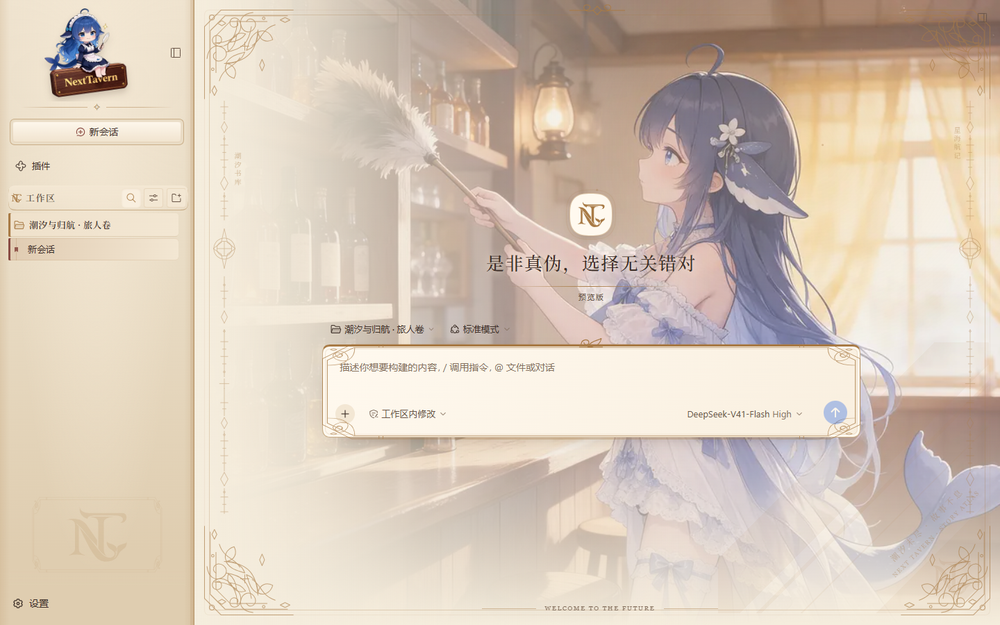
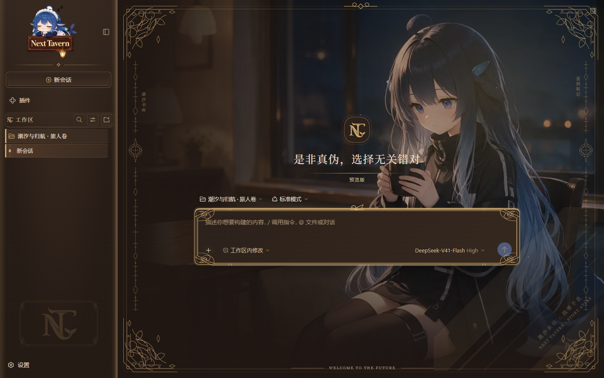

# NextTavern 琥珀酒馆 · Amber Tavern skin

NextTavern 自有皮肤 `dsh-nexttavern-amber` 遵循 DSH 官方皮肤协议：`cordis.patch.yml` 登记 loader 条目，`skin.json` 提供管理器元数据，客户端 CSS 由 `bodyAttr` 限定作用域。皮肤管理器显示名为“NextTavern 琥珀酒馆”；包名与皮肤 id 保持稳定。

## 当前设计与开发状态

维护中的设计回归暖木与纸页的酒馆氛围：左栏使用暖纸层次，左工作区大印章改用用户提供的铜色鲸娘徽章，其他 NT 标志保留；日夜主题各有鲸娘招牌和场景插画，输入区采用信笺样式，并配有克制的铜色装饰和柔和灯光。插画以内嵌 data URL 随客户端 bundle 提供，因为宿主通过共享 combo URL 加载客户端，不能假定同目录文件会单独提供。

灯光和光尘仅在空态场景显示，`prefers-reduced-motion: reduce` 时关闭。当前开发迭代已通过指定 TypeScript 入口编译和生成，以及隔离 Harness 下的桌面/390×844 手机侧栏、设置切换、工作区菜单和输入框定点检查。Reader 作者样式和真实 Roleplay 生成没有在本轮重验；移动视图沿用宿主布局，也不代表全面的响应式重构。

这次视觉改版尚未包含在官方 `0.2.9-rc.4` 发布包中。本说明描述维护中的源代码；实际发布状态以 NextTavern 官方发布说明为准。完整哈希、截图与逐项验证边界保存在维护仓库的专题记录中，发布到独立皮肤包时本文件保持自包含。

## 宿主钩子优先级

优先使用应用自带、跨构建稳定的属性，而不是 CSS module 的哈希类名：

| 用途 | 首选 | 兜底 |
| --- | --- | --- |
| 阅读滚动容器 | `[data-conversation-scroll]` | `[class*="_scrollBody"]` |
| 场景宿主 / 相位 | 最近带有 `data-phase` 的祖先 | `[data-slot='conversation.session']` |
| 品牌行 / 字标 | `[data-slot='sidebar.brand.mark']`、`[data-slot='sidebar.brand.name']` | `[class*="_brandMark"]`、`[class*="_brandName"]` |
| 侧栏 | `[data-slot='sidebar'] > *` | 由 `[class*="_logoRow"]` 向上找高而窄的祖先 |
| 正文行 / 输入区 | `[data-chat-flow-kind]`、`[data-composer-seat]`、`[data-composer-card]` | — |

场景层与 body 的相位镜像使用**不同**属性（`data-nt-stage` / `data-nt-scene`）；
两者同名会让 `querySelector` 先命中 `body`，清理时也会误删。视觉改版期间须继续跟随宿主场景生命周期，
并保留侧栏官方 slot 优先定位、移动端排版以及阅读器作者 CSS 优先级。

## 与宿主的三个硬契约

这三条都不是风格问题；写错任何一条皮肤都会**静默失效**——不报错、不生效、控制台干净。

1. **注册 id 必须是包名**，不是 `cordis.patch.yml` 里的条目 id。
   `__ModuleLoader__.load({ id })` 要匹配 bundle 行里的包名（`dsh-nexttavern-amber`）；
   写条目 id（`ui-skin-nexttavern`）会让整个 roster 报
   `loaded without registering <package> via __ModuleLoader__.load`。
2. **factory 返回的 namespace 必须打上 Module 标记**：
   `Object.defineProperty(ns, Symbol.toStringTag, { value: 'Module' })`。
   少了它条目会正常加载、`apply` 永远不会被调用，也不会有任何提示。
3. **`ctx.effect` 收的是 thunk**：`ctx.effect(() => cleanup, label)`。
   cordis 会**立即调用**传入的回调并把返回值当作 disposer；直接传 `cleanup`
   等于在挂载的同一 tick 里把皮肤拆掉，表现是样式和挂载节点随即消失。

排查以上任一情况看 `window.__ntSkinTrace`：`apply` 留下的带时间戳面包屑，
即使插件已被 cordis 回滚也仍然保留。

设置面板和皮肤表面应随当前明暗主题切换；酒馆阅读模式的墨色、排版由作者 CSS 控制，皮肤不覆盖作者规则。

## 内嵌美术资源

明暗两版侧栏鲸娘招牌及四张场景插画以内嵌 data URL 随客户端 bundle 提供。客户端通过共享 combo URL 加载，因此不依赖同目录静态资源被单独服务。

## 预览

`./preview/light.png` 与 `./preview/dark.png` 是随包提供的浅色和深色预览。





## 本地安装与玩家启用

本地开发时如需直接加载这个目录，可使用官方插件命令：

```bash
dsh plugin --profile web add <此目录>
```

正式用户应按 NextTavern 官方插件包的发行说明安装和更新；不要将历史手工复制目录步骤当作通用升级流程。每次实际部署须完成目标 audit、精确备份，并留存当次文件哈希与服务健康证据。

皮肤条目默认 `disabled: true`，所以安装后界面保持原样。启用时打开 **设置 → 插件市场 → 已安装**，切换 `dsh-nexttavern-amber`；如需关闭，在同处切回。选择保存在 profile 中，并在后续启动时继续生效。它是整页皮肤，与其他整页皮肤互斥，一次只启用一个。

该皮肤没有独立上游更新仓库；更新应随 NextTavern 官方插件版本进行。
